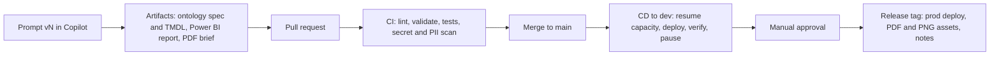

# Contoso Fabric IQ PromptOps

[](https://github.com/hrshl-demo/contoso-fabric-iq-promptops/actions/workflows/ci.yml)

**One prompt in, two outcomes out, shipped through CI/CD.** You write (or change) a prompt in GitHub Copilot. Copilot, using Microsoft's Fabric skills, produces an end-to-end **ontology** for a retail bank and **reports** on its data. Everything lands as a pull request; CI validates it; the pipeline deploys it to a Fabric workspace and promotes it to production after a manual approval.

Prompts, the ontology and the reports are all versioned in Git, so you can show what changed, why, and which prompt version produced it.

> All data is synthetic. No real customers, no real money.

## The cycle



## The two outcomes

| Outcome | Prompts | Lands in |
|---|---|---|
| **Ontology**: inspect, build, enrich, consume | `prompts/ontology/` | `kit/model/` (spec) and `fabric/` (Fabric item folders) |
| **Reports** on the dataset | `prompts/reports/` | `fabric/` (Power BI PBIR), `analysis/` (PDF brief) |

## Two parts

| Part | Repository | Builds | Doc |
|---|---|---|---|
| **1. The platform** | this one | From a blank subscription, by pipeline: a Fabric F4 capacity, a workspace, a lakehouse and the loaded medallion (the seed data is loaded straight from this repository; an optional storage account is the other data source). The only manual steps are a scripted identity set-up and two Fabric tenant settings, with guided links | [BOOTSTRAP.md](docs/BOOTSTRAP.md), [PLATFORM.md](docs/PLATFORM.md) |
| **2. The content** | a separate repository, started in its own session | The end-to-end ontology and the reports, from versioned prompts, through its own CI/CD into the platform's workspace | [CONSUMING.md](docs/CONSUMING.md), [the prompt to start it](docs/part2/NEW_SESSION_PROMPT.md) |

## What is in the repo

| Path | What |
|---|---|
| `prompts/` | The versioned prompts. Start with [prompts/README.md](prompts/README.md) |
| `kit/` | The deterministic engine: seed to bronze, silver (CDM and BIAN) and gold, a Direct Lake semantic model, a Gen 2 ontology, a graph and verification. See [kit/README.md](kit/README.md) |
| `seed/` | Synthetic seed data, read-only ([provenance](seed/PROVENANCE.md)) |
| `fabric/` | Fabric item folders generated from the spec (`python -m tools.export_fabric --write`): the Gen 2 ontology and the Direct Lake semantic model; reports go here too |
| `analysis/` | Analyses run by prompts. `analysis/monthly_brief` builds the [Monthly Business Brief](docs/reports/monthly-brief.md) PDF offline from the gold layer |
| `tools/` | Prompt lint, wrapper generation, manifest, PII guard, Fabric export, validation, deployment preview, release preparation, the deployment orchestrator (`tools/cd.py`), the platform orchestrator (`tools/platform.py`) and the identity bootstrap (`tools/bootstrap.py`) |
| `infra/` | The Bicep template of the platform: the Fabric capacity and, optionally, the storage account (the data source) |
| `.github/` | Workflows, Copilot instructions, a custom agent and generated prompt wrappers |
| `docs/` | [Architecture](docs/ARCHITECTURE.md), [decisions](docs/DECISIONS.md), [bootstrap](docs/BOOTSTRAP.md), [the platform pipeline](docs/PLATFORM.md), [consuming the platform](docs/CONSUMING.md), [releasing](docs/RELEASING.md), [the deployment pipelines](docs/SETUP.md), [the shortcut and Databricks pilot](docs/PILOT.md), `docs/generated/ontology-brief.md` (a readable view of every entity, synonym and PII flag) |
| `AGENTS.md` | The rules every agent follows: propose, never deploy |

## Drive it

1. **GitHub Copilot CLI or the Copilot app:** install the pinned Microsoft skills ([skills.lock](skills.lock)), ask the agent to plan first (Shift+Tab), then run a prompt, for example "run the ontology-build skill".
2. **VS Code:** type `/ontology.build` in Copilot Chat.
3. **Review the pull request** the agent opens: the prompt diff, the ontology diff, report previews, the CI summary.

The flow follows Microsoft's Fabric skills demo: **Inspect, Build, Enrich, Consume**.

## Pipelines

| Workflow | Does | Status |
|---|---|---|
| `ci.yml` | Prompt lint, wrappers, manifest, CHANGELOG structure, PII and secret scan, tooling tests, kit tests, offline build, drift check of the generated Fabric items, a deployment preview comment on every pull request, the Monthly Business Brief PDF and a preview of the release files as build artifacts | live |
| `cd-dev.yml` | After a merge that changes what is deployed: sign-in check, resume the F4, load the data if needed, deploy the semantic model and the ontology, build the graph, verify, pause the F4 (also when a step failed). Draft, off until `CD_ENABLED` is set ([SETUP.md](docs/SETUP.md)) | after identity setup |
| `release.yml` | Run by hand: checks the rules, runs the full kit tests, rebuilds the files from the commit, optionally deploys prod (only what dev had), and publishes a GitHub release with the PDF brief, the ontology brief, the Fabric items, the prompt library and checksums. A dry run is the default ([how](docs/RELEASING.md)) | live; prod deploy after identity setup |
| `capacity.yml` | Status, resume and pause of the F4 by hand, and a guard that pauses a running F4 every 3 hours unless a demo hold is set. Draft | after identity setup |
| `platform.yml` | Run by hand, on main, by an approver: `check` (free) tells which Fabric door is still closed; `build` (type BUILD) creates the F4, the workspace and the lakehouse (and a storage account with `CD_DATA_SOURCE=storage`), loads the data, asks a capacity admin to open the ontology gate while it loads, and pauses the F4; `destroy` (type DESTROY) removes it. Draft | after the bootstrap ([BOOTSTRAP.md](docs/BOOTSTRAP.md)) |

## Cost guard

Nothing bills until a person says so. The F4 capacity (East US 2) is paused between sessions, which keeps compute billing at zero. Every deploy ends with a pause, also when a step failed (`--keep-running` is ignored after a failure), the deployment steps have a deadline so the pause always has time, a final workflow step pauses again, and a guard pauses a forgotten F4 every 3 hours. Teardown (`wipe.sh`) stays a deliberate action on the machine that built the capacity, never a pipeline. See [docs/DECISIONS.md](docs/DECISIONS.md) and [docs/SETUP.md](docs/SETUP.md).

## Local checks

```powershell
python -m pip install -r requirements-ci.txt
python -m tools.check            # prompts, wrappers, manifest, PII guard, Fabric items
python -m pytest -q              # tooling tests
cd kit; python -m pip install -r requirements-dev.txt
$env:CONTOSO_REPO = "../seed"; python -m pytest -q -m "not slow"
```
