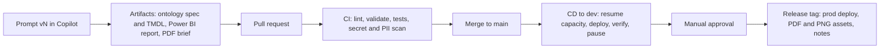

# Contoso Fabric IQ PromptOps

[](https://github.com/hrshl-demo/contoso-fabric-iq-promptops/actions/workflows/ci.yml)

**One prompt in, two outcomes out, shipped through CI/CD.** You write (or change) a prompt in GitHub Copilot. Copilot, using Microsoft's Fabric skills, produces an end-to-end **ontology** for a retail bank and **reports** on its data. Everything lands as a pull request; CI validates it; the pipeline deploys it to a Fabric workspace and promotes it to production after a manual approval.

Prompts, the ontology and the reports are all versioned in Git, so you can show what changed, why, and which prompt version produced it.

> All data is synthetic. No real customers, no real money.

## The cycle



## The two outcomes

| Outcome | Prompts | Lands in |
|---|---|---|
| **Ontology**: inspect, build, enrich, consume | `prompts/ontology/` | `kit/model/` (spec) and `fabric/` (Fabric item folders) |
| **Reports** on the dataset | `prompts/reports/` | `fabric/` (Power BI PBIR), `analysis/` (PDF brief) |

## What is in the repo

| Path | What |
|---|---|
| `prompts/` | The versioned prompts. Start with [prompts/README.md](prompts/README.md) |
| `kit/` | The deterministic engine: seed to bronze, silver (CDM and BIAN) and gold, a Direct Lake semantic model, a Gen 2 ontology, a graph and verification. See [kit/README.md](kit/README.md) |
| `seed/` | Synthetic seed data, read-only ([provenance](seed/PROVENANCE.md)) |
| `fabric/` | Fabric item folders generated from the spec and the prompts |
| `tools/` | Prompt lint, wrapper generation, manifest, PII guard, Fabric validation |
| `.github/` | Workflows, Copilot instructions, a custom agent and generated prompt wrappers |
| `docs/` | [Architecture](docs/ARCHITECTURE.md), [decisions](docs/DECISIONS.md) |
| `AGENTS.md` | The rules every agent follows: propose, never deploy |

## Drive it

1. **GitHub Copilot CLI or the Copilot app:** install the pinned Microsoft skills ([skills.lock](skills.lock)), ask the agent to plan first (Shift+Tab), then run a prompt, for example "run the ontology-build skill".
2. **VS Code:** type `/ontology.build` in Copilot Chat.
3. **Review the pull request** the agent opens: the prompt diff, the ontology diff, report previews, the CI summary.

The flow follows Microsoft's Fabric skills demo: **Inspect, Build, Enrich, Consume**.

## Pipelines

| Workflow | Does | Status |
|---|---|---|
| `ci.yml` | Prompt lint, wrappers, manifest, PII and secret scan, tooling tests, kit tests, offline build of the ontology and semantic model | live |
| `cd-dev.yml` | Resume the F4, deploy to the dev workspace, verify, pause | after identity setup |
| `release.yml` | Tag, manual approval, deploy to prod, attach PDFs and release notes | after identity setup |
| `capacity.yml` | Status, resume and pause of the F4 | after identity setup |
| `wipe.yml` | Manual teardown with an independent check | after identity setup |

## Cost guard

Nothing bills until a person says so. The F4 capacity (East US 2) is paused between sessions, which keeps compute billing at zero. Every deploy ends with a pause. See [docs/DECISIONS.md](docs/DECISIONS.md).

## Local checks

```powershell
python -m pip install -r requirements-ci.txt
python -m tools.check            # prompts, wrappers, manifest, PII guard, Fabric items
python -m pytest -q              # tooling tests
cd kit; python -m pip install -r requirements-dev.txt
$env:CONTOSO_REPO = "../seed"; python -m pytest -q -m "not slow"
```
