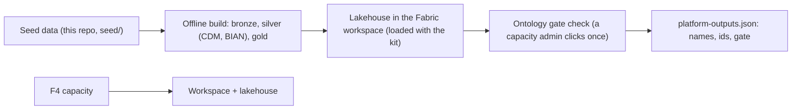

# The platform pipeline

Part 1 of the demo: **one pipeline builds everything from blank**, from the data source up to a lakehouse that holds the loaded medallion. The ontology, the semantic model and the reports are Part 2: a separate repository with its own pipeline that deploys into the workspace this one builds ([CONSUMING.md](CONSUMING.md)).



DRAFT: it is written against the documented Azure and Fabric calls and tested with fakes and the kit's Fabric mock. The first live run (4 Nov 2026) is the real test, and it found the first real problem: see "The data source" below.

## What it creates

| Thing | Created by | Lives in | Costs |
|---|---|---|---|
| Resource group (empty) | `bootstrap` | Azure | free |
| Storage account (Data Lake Gen2, closed to the public, Entra sign-in only, TLS 1.2) with the container `source`. **Only with `CD_DATA_SOURCE=storage`** | `platform build`, Bicep phase 1 | the resource group | cents a month |
| Fabric capacity F4, administrators: the people (by user principal name), the pipeline and the content repositories (by object id) | `platform build`, Bicep phase 2 | the resource group | USD 0.72 an hour while running, nothing while paused |
| Workspace (dev, and prod when asked), with roles | `platform build` | Fabric | free (it bills through the capacity) |
| Lakehouse `ContosoBankLH` and its tables (core tier: 32 gold tables) | `platform build`, the kit's `load` | the workspace | OneLake storage, negligible |

The template is [infra/main.bicep](../infra/main.bicep). CI compiles and lints it on every pull request, and the build asks Azure for a what-if before it creates anything.

## The data source

`CD_DATA_SOURCE` (a repository variable) chooses how the seed data reaches the lakehouse:

- **`repository` (the default):** the layers are built offline from the seed data in this repository (`seed/`) and loaded into the lakehouse as managed Delta tables. No storage account is created. This is the Fabric-native path the ontology needs anyway.
- **`storage`:** a storage account (the data source) is created, the seed data is uploaded to it, downloaded again and the layers are built from that copy.

Why `repository` is the default: the first live run (4 Nov 2026, a Microsoft demo subscription) created the storage account and Azure reported it with **public network access disabled**, although the template does not ask for that (it comes from the subscription's governance). GitHub-hosted runners reach a storage account only over its public endpoint, so the upload was refused (*"The request may be blocked by network rules of storage account"*) before the capacity existed, so nothing was billed. The pipeline does not override a tenant's network policy. Use `storage` only where the subscription leaves public network access on; the error text of a refused upload now names this variable.

## The order, and why

The capacity is created **last among the Azure resources** so that everything that can fail cheaply does so before the meter starts: sign-in, the Bicep what-if, (with `storage`: the storage account and the upload), the offline build. After the capacity exists the run is bounded by a deadline and ends with a pause.

| # | Step | Notes |
|---|---|---|
| 1 to 2 | Sign-in and a token for every service, the subscription | Fails here if the identity is wrong |
| 3 | Storage account | Only with `CD_DATA_SOURCE=storage`: Bicep phase 1, cents |
| 4 | Upload the seed data | Only with `storage`: Entra sign-in, three tries (a new account refuses its first calls for a short while) |
| 5 | Build the layers | `repository` (default): from the seed data in this repository. `storage`: download it again and build from that copy, which proves the data source is the source |
| 6 | **Create the capacity, or keep the one that exists** | Bicep phase 2, only when it does not exist or an administrator is missing. A capacity of another size stops the build (see below). Not started with less than 15 minutes left before the deadline. From here a pause is owed, whatever happens |
| 7 | Make sure it is running | The kit's `capacity resume` |
| 8 | Workspace, lakehouse, roles | Refuses a workspace that is on another capacity: the pipeline pauses only the capacity it knows, so a workspace elsewhere would bill unseen |
| 9 | **Ontology gate check, and the request to the admin** | Creates an empty ontology as a probe and deletes it (and the graph model Fabric creates next to it; it also removes what an earlier probe left behind, so a leftover cannot turn the answer into "unknown"). A leftover that cannot be removed stops the probe and fails the build (the create would answer 409 and tell nothing about the gate). A 403 `FeatureNotAvailable` is a closed gate. If closed, the run prints the link and the exact switches, then goes on |
| 10 | Load the layers | Only when tables are missing, or with `reload_data`. This takes about as long as the admin's click needs to apply, so the two overlap |
| 11 | Wait for the gate | Only if it is still closed, up to `gate_wait_min`, never beyond the deadline |
| 12 | Write the outputs | `platform-outputs.json` |
| 13 | **Pause the capacity** | Also after a failure, an interrupt or a deadline. The run reports `still running` loudly if the pause did not work |

## How it keeps the capacity from billing unseen

- **Typed confirmation, main only, approvers only.** `build` needs `BUILD`, `destroy` needs `DESTROY`, both only from `main` and only by an approver. The default action is the free `check`. Nothing runs on a schedule or a push.
- **A free `check` runs first** inside every `build`. A closed Fabric door stops the run before anything is created: the pipeline's access to the Fabric API, and (by creating and deleting an empty workspace without a capacity) its permission to create workspaces.
- **An existing capacity is never resized and never loses an administrator.** An ARM deployment of a capacity that exists is an update: it would set the size to F4 and replace the administrators. So the build reads what exists first: no capacity, create it; the right size and every configured administrator present, leave it alone (not deployed again); missing administrators, deploy with the existing ones plus the missing ones; another size, stop (the kit's rule too: a resize changes the bill). If the size or the administrator list cannot be read, the build stops too: a deployment would set the size to F4 and an update would replace administrators it cannot see.
- **Every step is bounded.** A stuck call is abandoned when the deadline (`CD_DEADLINE_MIN`, at most 45 minutes) ends, so the pause always has time, and the capacity is not even started with less than 15 minutes left. The capacity deployment itself is given less time than the step has. The job timeouts (100 minutes for `build`, 130 for `destroy`) are tested to cover the worst case.
- **A deployment that is still running behind the pause is cancelled and waited for first, and a cancel is not trusted to be an undo.** If the client gives up or the run is cancelled while Azure is creating the capacity, Azure carries on and could create a *running* capacity after the pause was tried. So before pausing, the run cancels the capacity deployment and waits (up to 4 minutes) for it to end. Then it looks at the capacity: one that is still being provisioned is waited for (up to 5 minutes, because it cannot be paused yet); after a cancel, a capacity that is not there yet is looked for for 90 seconds, because the capacity service can still finish what it had started, and is paused if it appears. Only a capacity that does not exist, with no deployment in doubt, is "nothing to pause". Whenever a deployment was in doubt (it had to be cancelled, it was cancelled by someone else less than 30 minutes ago, or it could not be stopped) the run cannot prove that nothing will appear later, so it ends in **exit 4** and a loud error: when no capacity appeared in the window (*the capacity may still appear and bill*), and when the capacity is paused but its deployment is still not over. It is green only when a capacity that appeared was paused, or no deployment was in doubt. A deployment that was cancelled longer ago than that is not in doubt any more, so one old cancelled record does not turn every later `destroy` red. A deployment that ends with an error that is not Azure's own "not found" (a sign-in or network failure) counts as not settled.
- **The pause is owed from the moment the capacity may be created or resumed** and is made in a `finally` block: after a failure, a Ctrl-C and a deadline. `--keep-running` is honoured only after a complete success: not after a failure, and not when a gate probe left something behind in the workspace.
- **A last line of defence** in the workflow signs in again (an OIDC sign-in lasts about an hour) and runs `python -m tools.platform rescue`: settle the capacity deployment, wait for the capacity to be provisioned or look for a late one, then pause the capacity, even when the job was cancelled or the step failed. It does nothing when no capacity exists and no deployment is in doubt. Both `build` and `destroy` have it.
- **`destroy` pauses what it resumed.** Purging a workspace needs a running capacity, so `destroy` resumes it, purges, and pauses it again in a `finally` block, also when the destroy fails.
- **The capacity guard** runs every 3 hours and pauses a running capacity. A forgotten F4 costs at most about USD 2.2.
- **One queue.** Builds, deployments and the guard share the concurrency group `fabric-capacity`; a running build is never cancelled by another.

## Re-running

`build` is idempotent. A second run finds the capacity (kept as it is, or only its missing administrators added), the workspace and the lakehouse (and the storage account, with `CD_DATA_SOURCE=storage`), sees the tables, skips the load and only resumes, checks the gate, writes the outputs and pauses. Use `reload_data` after the seed data or the layers changed.

## What it does not do

- It never changes a Fabric tenant setting or a capacity setting. It checks them and tells a person exactly where to click.
- It never resizes a capacity and never removes an administrator from one.
- The `check` proves the permission to create workspaces with an empty probe workspace that has no capacity. If Fabric refuses for another reason than the tenant setting, it is shown as skipped and the build checks again at step 8, which names both possible causes (the tenant setting, and the capacity administrator list).
- It does not create the ontology, the semantic model or reports. Those are Part 2.
- It does not use Databricks or OneLake shortcuts. The seed data is loaded into the lakehouse as Delta tables (straight from the repository, or through a storage account with `CD_DATA_SOURCE=storage`), which is the proven path for the ontology. Shortcuts and Databricks stay a pilot ([PILOT.md](PILOT.md), [DECISIONS.md](DECISIONS.md)).
- It does not override a tenant's network policy: if a policy turns off a storage account's public network access, use the default data source.

## Local use

```powershell
python -m tools.platform plan      --env dev     # settings and steps; calls nothing
python -m tools.platform preflight --env dev     # free and read-only, needs az signed in as the pipeline's identity
python -m tools.platform status    --env dev     # what exists and in what state
python -m tools.platform rescue    --env dev     # settle a capacity deployment, then pause the capacity if it exists
```

`build` and `destroy` exist locally too, but run them from the workflow: the workflow is where the guards, the approval and the last line of defence are.
