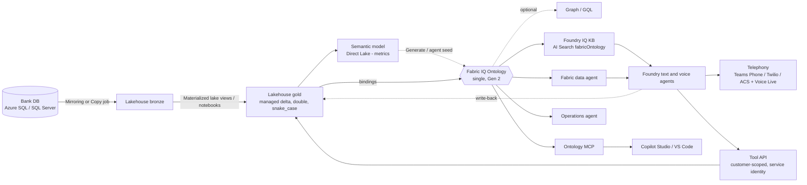

# Fabric IQ Ontology — Field Guide & Automation Blueprint
**Bank POC → one ontology as the backbone for conversational AI + voice** · as of **15 Oct 2026**

Legend: ✅ documented · 🧪 preview · ⚠️ known issue / gotcha · 🔎 inferred or unverified (validate live) · 📅 roadmap (planned, dates move)
Source tags like `[S4]` map to §13. A runnable kit that implements the blueprint is in `bank-ontology-as-code/` (§6.7).

---

## 1. Executive summary

**Verdict:** yes — one Fabric IQ ontology can be the shared semantic contract for chat *and* voice agents, and most build/promote work can be scripted today. Four gaps shape the design:

1. **Still preview.** Ontology item GA is planned **Q1 2027** 📅 `[S24]`. The original JSON experience (Gen 1) **retires 31 Jan 2027** ✅ `[S1]`. Build only on the new **Gen 2 (TMDL)** format.
2. **Automation is real but partial.** ✅ REST, Python SDK, Fabric CLI, Git integration and deployment pipelines all handle the TMDL definition `[S4][S5][S27][S29]`. ⚠️ *Generate ontology from semantic model*, item sharing and *Prep data for AI* have **no API**. ⚠️ An ontology created only via REST is **graph‑ineligible** until undocumented `ONT_*` partition annotations are added (open bug filed 13 Oct 2026) `[S26]`. Verified live on 16 Oct 2026: adding only the annotations makes every entity eligible, so the kit now writes them by default.
3. **Runtime identity is the hard part for voice.** Foundry IQ's Fabric‑ontology knowledge source needs an **end‑user token (OBO)** `[S19]`; the ontology MCP server **doesn't accept service principals** yet ⚠️ `[S12][S14]`; the data agent accepts a service principal (🧪, not managed identity, not KQL) `[S22]`. Bank *customers* aren't Entra users → they need a deterministic Tool‑API tier; employees (RM/agent‑assist) can use OBO.
4. **No public data‑plane query API yet** (📅 Q4 2026) `[S24]`; the Python SDK exposes management only `[S27]`. MCP is today's programmatic read path.

**Recommended approach — *Seed → Template → Compile → Promote*:** generate artifacts from one spec, capture the service's own binding plumbing with **one** portal seed, treat exported TMDL in Git as the merge point after that, promote with deployment pipelines.

**Five rules I'd hold to for the POC**
- Bind entities to **lakehouse delta tables** (graph‑eligible, data‑agent compatible); use the semantic model for **metrics + seeding**, not as the binding source ⚠️ `[S7][S14]`.
- Money as **double**, no spaces/special characters in physical column names, **managed** tables, single‑column string/int keys `[S7][S14]`.
- Treat ontology **rules as advisory context** — they aren't executed and `ask_ontology` ignores them ⚠️ `[S8][S3]`; enforce hard rules in the Tool API / agent layer.
- Avoid **inheritance** for the voice backbone for now (polymorphic parent queries unavailable via agent/MCP) ⚠️ `[S3][S14]`.
- Keep **NL‑to‑query out of the per‑turn voice path**: prefetch a customer snapshot at call start; use deterministic tools for transactions (§8).

---

## 2. What ontology is (Oct 2026)

### 2.1 Position and mental model
Ontology (preview) is Fabric IQ's **business‑context layer**: entity types, properties, relationships, metrics, rules and **bindings to data that stays where it is** — it is *not* a data store or query engine; consumers query the bound sources `[S1]`. Graph in Fabric is an **optional** execution layer (multi‑hop, paths); routine lookups/aggregations stay on the source engines `[S1][S10]`.

| Concept | Meaning | Notes |
|---|---|---|
| Entity type / instance | Reusable business concept / a data‑backed occurrence | Key = string or integer; keyless types exist but aren't graph‑eligible `[S7][S10]` |
| Property | Typed characteristic | Types: integer, boolean, datetime, double, string; time‑series types; untyped allowed until bound `[S7]` |
| Relationship | Typed link between entity types | Can use a mapping table, or none (direct column link) `[S18]` |
| Metric | Governed calculation from a **semantic‑model DAX measure** | Proxy: link + DAX resolved on demand; **doesn't auto‑refresh** `[S9]` |
| Rule | Natural‑language business logic linked to concepts | Read via MCP `list_ontology_rules`; **not executed**; no Activator integration in Gen 2 `[S8]` |
| Namespace | Scope for names (RDF‑style); `default` always exists | One namespace per concept `[S18]` |
| Data binding | Maps properties/relationships to source columns | One static binding per entity; many time‑series bindings `[S7]` |

### 2.2 Gen 1 vs Gen 2 (why format matters for automation)
| | Gen 1 (old) | Gen 2 (new, default) |
|---|---|---|
| Definition format | JSON parts: `EntityTypes/{id}/definition.json`, `DataBindings`, `Contextualizations` | **TMDL**: embedded Direct‑Lake tables + ontology extensions `entity`, `entityRelationship`, `namespace`, `rule` `[S4]` |
| Created via UI? | No (API/CI‑CD only) `[S1]` | Yes |
| Rules | Activator‑integrated alerts | NL statements only `[S8]` |
| Modeling | Basic | Namespaces, inheritance, shared properties, keyless, relationships without join tables, metrics, versions, RDF/OWL import `[S1]` |
| Retirement | **31 Jan 2027** | — |
| Tooling coverage | Terraform `fabric_ontology`, `fabriciq-ontology-cli` skill, fabric‑cicd samples, most community notebooks | Official TMDL reference + WindFarm sample; tooling is catching up ⚠️ `[S26][S27]` |
| Item property | `properties.generation = 1` | `= 2`; **omitting `definition` on create yields Gen 2** `[S5][S6]` |

Migration: in‑product "create a copy in the new experience" preserves the original; fails if the old ontology has "Defined at binding" properties or composite keys; downstream agents/dashboards must be re‑pointed; Activator rules must be rebuilt `[S1][S14]`.

### 2.3 Data sources and binding rules `[S7][S14][S1]`
- Sources: lakehouse, eventhouse/KQL DB, warehouse, SQL database, **mirrored database**, semantic model; OneLake shortcuts/views/materialized views.
- **One static binding per entity** (OneLake‑backed); **multiple time‑series** bindings (eventhouse + lakehouse OK). Time series must be columnar (one row per timestamped observation).
- Lakehouse tables must be **managed** (not external) and **without column mapping**. Fabric auto‑enables column mapping when column names contain `, ; { } ( ) \n \t =` or **space** → rename columns up front.
- **Decimal** is returned as null in Graph → use **double** (decimal columns generated from a semantic model "return null") ⚠️.
- Binary/Variant → string in graph. Entity keys: string/integer only.
- Eventstream data binds by landing it in an eventhouse `[FAQ]`.

### 2.4 Querying `[S3][S10]`
The ontology agent picks the engine per binding: **SQL** (lakehouse), **KQL** (eventhouse), **DAX** (semantic model), **GQL** (graph traversals, ISO GQL not openCypher). Defaults: KQL/SQL/GQL ≤ 1,000 rows, DAX ≤ 200. Graph materialization is opt‑in ("Manage graph"), takes minutes→hours, **doesn't refresh when source rows change** (schedule or refresh manually) and consumes capacity.
Graph eligibility: key required; delta tables from **lakehouse/mirrored DB only**; no semantic‑model/eventhouse bindings; no multi‑table backing; time series collapse to base type.

### 2.5 Modeling features `[S18][S11]`
- **Namespaces** (`namespaces/{ns}.tmdl`, entity files `ns#Name.tmdl`); graph prefixes labels with the namespace.
- **Inheritance**: single parent; derived types inherit properties (not bindings/relationships/entity metadata); polymorphic queries span base + direct children ⚠️ (parent→children query unavailable via agent/MCP).
- **Shared/reusable properties**, **untyped properties** (assign type by binding).
- **Metadata**: descriptions, **synonyms (entity types only)**, key‑value attributes (e.g. `unit`, `sensitivity`); data‑agent query generation doesn't use metadata directly — only schema interpretation benefits `[S18]`.
- **Resource links** (Power BI reports on entity types), **version history** (manual named versions; restore replaces the definition).
- **RDF/OWL/TTL import** into an **empty** ontology only (Class→entity, DatatypeProperty→property, ObjectProperty→relationship, single parent `subClassOf`→inheritance, label/comment/altLabel→name/description/synonym; restrictions, transitivity etc. dropped); **export TTL/RDF** (not OWL) `[S11]`. Useful for seeding from industry vocabularies (e.g. FIBO modules) 🔎.

### 2.5 Governance, security, billing `[S15][S17][S1]`
- Workspace roles + item sharing (Read / Write / **Reshare**); **sharing is portal‑only**, changes can take up to 2 h. Viewers can query/explain; creating/applying changes needs Contributor+.
- Source security is honored: OneLake security, RLS/CLS/OLS. Semantic‑model use needs **Read + Build**.
- Git integration + deployment pipelines list **Ontology (preview)** `[S29]`; CMK is 📅 Q4 2026.
- Capacity meters: *Ontology Discovery* (1,000 CU‑s per definition read; listed non‑billable in preview), *Logic & Operations* (child graph/eventhouse, billable at child rate), *AI Reasoning* (dynamic; examples ≈0.5–1 CU‑h light edit, ≈20 CU‑h heavy generation). Start evaluation on **F8** (F4 for light tests). Close idle ontology tabs (auto‑refresh ≈ every 20 min adds Discovery reads). Rates can change.

---

## 3. What's new in 2026 (verified timeline)

| When | Capability | Status |
|---|---|---|
| Q1 | Rules integrated with Activator (Gen 1 only) | shipped; Gen 1 retiring |
| Q2 | Ontology integrations: Copilot Studio, Data agent, Foundry IQ, Operations agent, Agent 365/M365 Copilot | 🧪 shipped `[S24]` |
| Q2 | **Ontology MCP endpoint — query tools** | 🧪 shipped |
| Q2 | Untyped properties, resource links, scaled canvas; **Fabric Graph GA** (private network, OneLake security, outbound protection) | shipped |
| Q3 | **Updated Ontology experience** (Gen 2): full canvas, migration, **versioning**, graph integration, upgraded **data‑agent integration** (8 Oct) | 🧪 shipped |
| Q4 | **Namespaces** (roadmap: shipped, updated 2 Oct) | 🧪 shipped `[S24]` |
| FabCon Barcelona (Oct) | **Unified semantic modeling**: reuse Power BI **DAX measures + calculated columns**; simplified bindings (OneLake shortcuts, mirrored DBs); **AI ontology agent (proposal‑first)**; NL rules; relationships without join tables, keyless bindings, complex relationships, reusable properties, inheritance, namespaces; Overview/Instances views; version history; **RDF/OWL import‑export**; public **REST, SDKs, MCP**; Git/CI‑CD | 🧪 public preview `[S25]` |
| Related | **Power BI Authoring MCP** (local GA; hosted 🧪), **Power BI Agentic Experiences** (GA, some parts preview), **Fabric data agents in Copilot Studio** (GA), data agent: deep‑thinking, UDFs as tools, *Build agent with AI* (🧪), **Osmos** data‑engineering agent (🧪), mirroring **Change Data Feeds** (GA), **materialized lake views** (GA core), pipeline **Fabric API activities** (announced) | `[S25]` |

📅 Planned (Fabric roadmap mirror, updated 14 Oct): **Public query API for Ontology – Q4 2026**, **CMK – Q4 2026**, **Ontology Health – Q4 2026** (slipped between Q4'26 and Q1'27 several times), **Ontology item GA – Q1 2027**. Management SDK and query API are tracked separately `[S24]`.

---

## 4. Consumption surfaces for chat & voice

| Surface | Use it for | Status | Runtime identity | Watch‑outs |
|---|---|---|---|---|
| **Ontology agent** (in portal) | Create/improve/test ontology; query | 🧪 | Delegated user | Plan vs Act; session‑only chat (≤24 h); AI processing region rules (§10) |
| **Foundry IQ** (AI Search knowledge source `kind: fabricOntology`) | Foundry text & voice agents; mix with SOP index in one KB | 🧪 | **End‑user OBO** token via `x-ms-query-source-authorization` (audience `https://search.azure.com/.default`) | Same Entra tenant; reasoning effort `low`/`medium` only; returns `fabricAnswer` + `fabricRawData` `[S19]` |
| **Ontology MCP server** | Copilot Studio, VS Code/GitHub Copilot, custom agents; tools include `list_ontology_entity_types`, `search_ontology`, `list_ontology_rules` | 🧪 | User | ⚠️ **No service principal** (known issue); URL `…/v1/mcp/dataPlane/workspaces/<ws>/items/<ontology>/ontologyEndpoint` `[S12]` |
| **Fabric data agent** | Governed NL Q&A; Foundry "Fabric data agent" tool; Copilot Studio (GA) | 🧪 w/ ontology | User **or SPN** (🧪; not MI; not KQL sources) | ⚠️ Not with ontologies bound to **semantic models**; add instruction `Support group by in GQL`; relationship names must be unique; first queries may fail while it warms up `[S13][S22]` |
| **Copilot Studio** (Fabric IQ MCP tool) | Low‑code agents | 🧪 | Entra sign‑in | Prod environment with ontology MCP tools allowed |
| **Operations agent** | Continuous monitoring + Teams actions | 🧪 | Agent item; approvals in Teams 🔎 | ⚠️ Same semantic‑model‑binding issue |
| **Agent 365 / M365 Copilot** | Employee Copilot experiences | 🧪 | User | Optional |

**Two‑tier identity model for a bank** 🔎 (design recommendation):
- **Tier 1 – employees** (RM assist, dealer desk, contact‑centre agent assist): Entra users → OBO flows (Foundry IQ, MCP, Copilot Studio) enforce **per‑user** RLS/CLS.
- **Tier 2 – customers** (IVR, app voice, WhatsApp): no Entra identity → don't point NL‑to‑query at PII with a broad SPN. Use a **Tool API** (service identity, parameterised, customer‑scoped) for balances/cards/transactions, and use the ontology as the **vocabulary + policy + definitions contract** (tool schemas, synonyms, rules, metrics). The data agent via SPN is acceptable only over **non‑customer‑specific, curated** content.

---

## 5. Reference architecture


"Single ontology" = one logical model; physically **one item per environment** (Dev/Test/Prod) promoted through the pipeline; use **namespaces** (not extra ontologies) to separate domains.

---

## 6. Automation blueprint

### 6.1 What can and can't be automated
| Layer | Automatable? | How | Caveat |
|---|---|---|---|
| Workspace, capacity, tenant, SPN access | ✅ | Terraform / Fabric REST / CLI | Tenant settings are admin‑only |
| Source replication | ✅ | Mirroring (Azure SQL DB, Snowflake un‑flagged; SQL Server, SQL MI, PostgreSQL, Cosmos DB marked preview) or Copy job `[S30]` | Verify your source's status |
| Gold layer | ✅ | Notebooks / **materialized lake views** (+ MLV job/schedule APIs) / dbt jobs (GA) | MLV outputs are delta tables |
| Semantic model | ✅ | REST create/update with **TMDL**, `semantic-link-labs`, **Power BI Authoring MCP** (local GA / hosted 🧪), Skills for Fabric | ⚠️ *Prep data for AI* (AI instructions, AI data schema, verified answers) has **no supported programmatic route** `[S31]` |
| Ontology item create/read/update/delete | ✅ | REST, `microsoft-fabric-api` SDK, Terraform (empty item), Fabric CLI export/import, Git | SPN/MI supported on the management plane `[S5]` |
| Entities/relationships/rules/namespaces | ✅ | TMDL parts via `updateDefinition` (replaces **all** parts) | Portal‑authored enrichment lives in the same files |
| **Generate ontology from semantic model** | ❌ UI / agent only | Button on the semantic model ribbon; agent for multi‑model merge | Seed once, then export |
| Synonyms, KV metadata, **metrics**, resource links | 🔎 partial | TMDL syntax not in the public reference | Seed via portal/agent, round‑trip with `export` |
| Graph materialization / refresh | ⚠️ partial | Portal "Manage graph" + schedule | REST‑only graph models aren't queryable until opened once in the portal `[S28]` |
| Item sharing | ❌ | Portal only `[S17]` | Use workspace roles in automation |
| Data agent wiring | 🔎 partial | Definition REST exists; documented source types omit `ontology` `[S23]` | Seed in portal, export via Git |
| Foundry IQ KS/KB, Foundry & voice agents | ✅ | AI Search REST `2026‑08‑01‑preview`; Foundry SDK/azd | Preview headers `[S19][S20]` |

### 6.2 Strategy: Seed → Template → Compile → Promote
Why: Gen 2 accepts any valid TMDL, but the portal writes **binding plumbing the docs don't describe** (the `ONT_*` partition annotations, the Direct‑Lake expression name), `updateDefinition` **replaces the whole definition**, and portal enrichment (synonyms, metrics) lives in the same files. So:

1. **Compile** semantic model + ontology skeleton from one spec (kit `build`).
2. **Seed once in the portal** (Generate ontology from the Direct‑Lake model, or the ontology agent) to capture the service's own bindings; enrich (synonyms, metadata, metrics); create a named version.
3. **`export`** the definition → commit to Git = **golden definition**.
4. **Compile with `--seed`** for new environments (reuses the seed's expression + annotations).
5. **Promote** with Git + deployment pipelines (or `fabric-cicd` with `find_replace` for workspace/lakehouse IDs).

**Ownership boundary** — before step 2 the *spec* owns structure; after step 3 **Git/TMDL owns everything**. Do **not** re‑apply a spec over an enriched ontology (`apply` skips existing items; `--replace` backs up first but will overwrite portal enrichment).

### 6.3 Runbook (bank POC)

**Step 0 – Prerequisites** `[S16][S2][S22][S5]`
- Tenant: *Users can create Fabric items*, *Users can create ontology (preview) items*; for data agent: Copilot + Azure OpenAI + cross‑geo AI processing/storing; *Service principals can use Fabric APIs* (automation + data‑agent SPN).
- Capacity F8 (F4 light); **not** *My workspace*; SPN = workspace **Contributor**; Read+Build on the semantic model for generation.
- Lakehouse workspace with **inbound public access enabled** if you rely on Direct‑Lake‑generated bindings 🔎 (documented as a requirement for generated bindings; validate under private link).

**Step 1 – Provision (IaC)**
```hcl
provider "fabric" { preview = true }                        # fabric_ontology is a preview resource (check provider docs for exact arguments)
resource "fabric_workspace" "bank" { display_name = "bank-iq-dev"  capacity_id = var.capacity_id }
resource "fabric_lakehouse" "bank" { display_name = "BankLH"  workspace_id = fabric_workspace.bank.id }
resource "fabric_ontology"  "bank" { display_name = "BankOntology" workspace_id = fabric_workspace.bank.id }  # no definition => Gen 2 empty item
```
⚠️ The provider's `definition` map accepts only **Gen 1 (`Default`) paths** today `[S27]` — use it for the empty shell; push the TMDL with REST/CLI. (Fabric CLI: `fab create ws.Workspace/BankLH.Lakehouse -P enableSchemas=true`.)

**Step 2 – Ingest + normalise** (Copy job / Mirroring, then notebook)
```python
import re
from pyspark.sql import functions as F, types as T
def to_gold(df):
    for c in df.columns:                                   # no spaces/special chars => no delta column mapping
        df = df.withColumnRenamed(c, re.sub(r"[^0-9a-zA-Z_]+", "_", c).strip("_").lower())
    for f in df.schema.fields:                             # Graph returns null for decimal
        if isinstance(f.dataType, T.DecimalType): df = df.withColumn(f.name, F.col(f.name).cast("double"))
    return df
to_gold(spark.table("bronze.customer")).write.mode("overwrite").format("delta").saveAsTable("dbo.customer")  # managed table
```

**Step 3 – Gold views (declarative, with data quality)** 🔎 pattern
```sql
CREATE MATERIALIZED LAKE VIEW IF NOT EXISTS dbo.account
( CONSTRAINT id_present CHECK (account_id IS NOT NULL) ON MISMATCH DROP )
AS SELECT a.account_id, a.customer_id, /* … */ CAST(a.current_balance AS DOUBLE) AS current_balance,
          DATEDIFF(current_date(), MAX(t.txn_date)) AS days_since_last_txn
   FROM silver.account a LEFT JOIN silver.txn t USING (account_id) GROUP BY ALL;
```

**Step 4 – Semantic model as code** (kit)
```powershell
python ontology_as_code.py apply --workspace-id <ws-guid>                 # dry run: validates + prints plan
python ontology_as_code.py apply --workspace-id <ws-guid> --execute --refresh
```
Direct‑Lake on OneLake (`AzureStorage.DataLake`) with `EntityPartitionSource`, explicit measures, `discourageImplicitMeasures`, hidden keys, business‑friendly names and ≤200‑char descriptions (Copilot reads only the first 200 chars) `[S31]`. Alternatives: `semantic-link-labs.generate_direct_lake_semantic_model(dataset, tables, source, …)`, or an agent with the **Power BI Authoring MCP**. Smoke‑test with DAX `EVALUATE {[Total Balance]}`. **Manually** configure *Prep data for AI* (AI instructions ≤10k chars, AI data schema, verified answers).

**Step 5 – Seed the ontology in the portal** (one time)
- Option A: semantic‑model ribbon → **Generate ontology**. Option B: empty ontology → **Start with Ontology agent** (Plan → review draft → Act). Merge more models via the agent only.
- Verify: entity bindings point at **lakehouse tables**, not the semantic model; **Manage graph** shows **Eligible**; **Test the ontology** returns 5 grounded answers; add synonyms/descriptions; **create a named version**.

**Step 6 – Capture golden definition**
```powershell
python ontology_as_code.py export --item ontology --workspace-id <ws> --name BankOntology --out golden/BankOntology.Ontology
# or: fab export <ws>.Workspace/BankOntology.Ontology -o golden      (Ontology added to CLI export/import/bulk export on 23 Sep 2026 — use the latest CLI)
git add golden && git commit -m "golden ontology definition"
```

**Step 7 – Bootstrap other environments**
```powershell
python ontology_as_code.py build --seed golden/BankOntology.Ontology --workspace-id <ws-test> --lakehouse-id <lh> --workspace-name <name>
python ontology_as_code.py apply --seed golden/BankOntology.Ontology --workspace-id <ws-test> --execute
```
Without a seed the kit emits the documented `Sql.Database` expression; `--ont-annotations` adds the 8 undocumented `ONT_*` annotations (experimental).

**Step 8 – Publish to consumers**
- *Foundry IQ* (verified shapes): `PUT {search}/knowledgesources/bank-ontology-ks?api-version=2026-08-01-preview` with `{"name":"bank-ontology-ks","kind":"fabricOntology","fabricOntologyParameters":{"workspaceId":"<ws>","ontologyId":"<ont>"}}`; put it in a KB with `retrievalReasoningEffort:{"kind":"low"}`, add your SOP index as a second source; at query time send **both** the search credential and `x-ms-query-source-authorization: <user token for https://search.azure.com/.default>`; set `includeReferenceSourceData:true` to receive `fabricAnswer`/`fabricRawData`.
- *MCP*: `.vscode/mcp.json` → `{"servers":{"bank-ontology":{"type":"http","url":"https://api.fabric.microsoft.com/v1/mcp/dataPlane/workspaces/<ws>/items/<ont>/ontologyEndpoint"}}}`; Copilot Studio → add **Fabric IQ MCP (Preview)** tool with Workspace ID + Ontology ID.
- *Data agent*: portal → add ontology source → instruction `Support group by in GQL` → publish; grant SPN workspace + every data source `[S22]`.
- *Voice agent*: §8.

**Step 9 – CI/CD & quality gates**
- Git integration (Azure DevOps/GitHub) per environment; deployment pipelines (Ontology supported, preview); `fabric-cicd` has an `Ontology` publisher (parameterise IDs via `find_replace`); `fab export|import|bulk export`; `microsoft-fabric-api` 0.1.0b29 has `create/get/update/delete_ontology`, `begin_get/update_ontology_definition`.
- Gate each PR: `ontology_as_code.py validate <folder> --strict` + golden‑question regression through the ontology agent / data agent / Foundry evaluation.
- ⚠️ Don't use the `fabriciq-ontology-cli` skill or Terraform `definition` for Gen 2 — they emit Gen 1 `[S26][S27]`.

### 6.4 Gen 2 definition anatomy (from the official WindFarm sample `[S4]`)
```
.platform                      metadata.type = "Ontology", config.version = "2.0"
database.tmdl                  database / compatibilityLevel: 1000000
model.tmdl                     model Model + ref table|entity|namespace|rule …  (service synthesizes if omitted)
expressions.tmdl               shared M expression (Direct‑Lake source)
tables/{T}.tmdl                backing table: columns + `partition … = entity / mode: directLake`
relationships.tmdl             table relationships (fromColumn / toColumn)
entities/{ns#}{E}.tmdl         entity { backingTable, keyProperty, property { dataType, backingConfiguration { valueColumn } } }
entityRelationships.tmdl       entityRelationship { fromEntity, toEntity, backingConfiguration { relationship } }
namespaces/default.tmdl        required; ref'd from model.tmdl
rules/{Rule}.tmdl              rule { statement, ruleReferencedEntity / Property / Relationship }
```
Minimum you may send: `.platform` + `database.tmdl`. Semantic‑model parts live under `definition/…`; **ontology parts are at the item root**. Time‑series properties use `dataType: TimeSeries<double>`, `backingConfiguration { type: timeSeries, valueColumn, orderingColumn }` plus `additionalBackingTable`.

### 6.5 ⚠️ The REST‑created ontology gotcha
A TMDL ontology created via REST is accepted and round‑trips, yet **Manage graph shows every entity Ineligible** ("data source kind couldn't be identified"). Reporter fixed it by copying the portal's partition: `expressionSource: 'DirectLake - <lakehouse>'` + annotations `ONT_WorkspaceId, ONT_ItemId, ONT_ItemKind=Lakehouse, ONT_ItemName, ONT_WorkspaceName, ONT_SqlEndpoint, ONT_SqlDatabase, ONT_PinnedAtUtc` (which subset is required is untested; not in the reference as of 14 Oct) `[S26 #107]`. Mitigation in the kit: **verified live on 16 Oct 2026 (South India, F4): adding only the eight annotations, with the `Sql.Database` expression and `schemaName: dbo` left as they were, turned all 31 entities from Ineligible to Eligible, so the kit now writes them by default (`--no-ont-annotations` turns them off)**; **`--seed`** (copy the portal's own expression + annotations) remains the fallback. Validate with Manage graph after every first deploy.

**Graph over REST, verified live (16 Oct 2026, East US 2, F4).** The graph model that Fabric creates next to the ontology can be filled without the portal wizard: `POST /v1/workspaces/{ws}/graphModels/{id}/updateDefinition?updateMetadata=false` with the five files the wizard writes (`graphType.json`, `dataSources.json`, `graphDefinition.json`, `stylingConfiguration.json`, `graphSettings.json`) is accepted, Fabric starts a refresh by itself (a second `refreshGraph` request is answered `JobInstanceStatusDeduped`), and about 2 minutes later the graph answers GQL (`MATCH (c:Customer) RETURN count(c)` returned 38; 31 node types, 53 edge types). The node and edge aliases are the ontology lineage tags, so the whole definition is derivable from the ontology specification; the kit generates and applies it (stage 3 of `build.sh`, `oac.build_graph`). A refresh of a graph that has no definition yet is cancelled within seconds.

### 6.6 Ontology‑agent prompts for the bank POC (use **Plan** mode first)
1. *Scope:* "Model a retail bank: customers, accounts, transactions, cards, loans, branches, products and customer interactions. Use only the BankLH lakehouse tables and the BankSemanticModel. Ignore everything else in this workspace."
2. *Draft:* "Propose entity types with keys, properties and bindings to BankLH tables, relationships (e.g. Account held by Customer, Transaction on Account, Loan granted to Customer) and bind **not** to the semantic model. Flag any decimal columns and any column names containing spaces."
3. *Enrich:* "Add synonyms: Customer = client/account holder/caller; Account = bank account/savings account/a/c; Loan = EMI/credit facility. Mark Customer.MobileNumber, Customer.Email, Account.AccountNumber as sensitivity=PII."
4. *Validate:* "Test the ontology" → then: "How many accounts are dormant (ACTIVE and no transaction for 180 days)? Show the query." and "Which Mumbai‑branch loans are 90+ days past due? Use graph only if needed."
Switch to **Act** only after reviewing the draft preview; patches preserve stable IDs.

### 6.7 The kit (`bank-ontology-as-code/`)
`spec/bank_poc.yaml` → `ontology_as_code.py` → `out/` (semantic‑model parts, Gen 2 ontology parts, REST payloads, `grounding/agent_brief.md`).
| Command | What it does |
|---|---|
| `build` | Spec → TMDL for both items + payloads + agent brief; validates both |
| `validate <folder> [--strict]` | Static checks on any ontology/semantic‑model export (references, keys, types, relationship integrity, rule refs, duplicate names, decimals, column‑mapping chars, placeholders) |
| `apply [--execute] [--replace] [--refresh] [--seed DIR]` | Dry‑run by default; create‑if‑missing with LRO polling, 429 retry, lakehouse/SQL‑endpoint auto‑resolve; `--replace` backs up the live ontology first |
| `export --item ontology\|semanticModel` | `getDefinition` → folder (seed/backup/Git) |

**Test evidence (offline):** 26 unit tests pass, including (a) the validator accepting Microsoft's **official WindFarm sample** (35 parts, 12 entities, 10 relationships, 1 rule → 0 errors/0 warnings), (b) negative mutations being caught, (c) builder invariants and base64 payload round‑trip, (d) `apply`/`export` against a **mock Fabric service** covering 202+LRO polling, 429 throttling, correct token audience per API, idempotent re‑run, `--replace` (backup + `updateMetadata=false`, `.platform` only for ontology) and export round‑trip.
**Not yet proven:** it has **not been run against a live tenant**. It emits only syntax proven by the sample/guidelines; it does **not** emit synonyms, KV metadata, top‑level metrics, resource links or graph/data‑agent config (seed those, then export).

---

## 7. Bank POC reference model

Assumptions: Azure SQL/SQL Server bank schema + a small `customer` table (dozens–thousands of rows). Replace names in `spec/bank_poc.yaml`; synthetic data outside prod.

**Entities (8)** — key → notable properties
| Entity | Key | Notes / synonyms |
|---|---|---|
| Customer | CustomerId | FullName, DateOfBirth, MobileNumber, Email (**PII**), Segment, KycStatus, RiskRating, **PreferredLanguage**, **PreferredChannel**; *client, caller, account holder* |
| Account | AccountId | AccountNumber (**PII**), AccountType, AccountStatus, CurrentBalance, AvailableBalance, DaysSinceLastTxn; *a/c, savings account* |
| Transaction | TxnId | TxnTimestamp, TxnAmount, TxnDirection, TxnChannel, Counterparty, TxnStatus; *payment, transfer, txn* |
| Card | CardId | CardType, CardStatus, CreditLimit, CardLast4; *debit/credit card* |
| Loan | LoanId | PrincipalAmount, OutstandingAmount, EmiAmount, DaysPastDue, LoanStatus; *EMI, credit facility* |
| Branch / Product | BranchId / ProductId | Region, IfscCode / ProductFamily, MinimumBalance |
| Interaction | InteractionId | Intent, Sentiment, ResolutionStatus, HandledBy — **written back by agents** so the next call has context |

**Relationships (10, unique names):** Account Held By Customer · Account Of Product · Account At Branch · Customer Served By Branch · Transaction On Account · Card Issued To Customer · Card Linked To Account · Loan Granted To Customer · Loan Of Product · Interaction With Customer.
**Rules (7, advisory):** DormantAccount (≥180 d) · HighValueTransactionReview (₹10 lakh *sample*) · NpaClassification (≥90 DPD) · KycGate · MaskSensitiveIdentifiers · StepUpForCardChanges · HonourLanguagePreference. *Replace thresholds with your bank's policy.*
**Metrics (15 DAX measures):** Total Balance, Dormant Accounts, Total Debits/Credits, Gross NPA %, Active Cards, Negative Sentiment %, …

**Gold‑layer conventions:** snake_case physical columns; one string/int key per table (surrogate if composite); money = double; dates/timestamps in UTC; `days_since_last_txn` etc. computed in MLVs; hide FK/technical columns in the semantic model; PII columns tagged and protected with OneLake **CLS** for non‑privileged readers.

**Which engine answers what**
| Question | Best path |
|---|---|
| "What's my balance / block my card" (customer) | Tool API (deterministic, step‑up auth) |
| "Which of my clients have KYC expiring and a loan 60+ days past due?" (RM) | Ontology via Foundry IQ / data agent (OBO) → SQL/GQL |
| "Gross NPA % by region" | Metric (DAX) |
| "What does 'dormant' mean here?" | Rule + synonyms via MCP `list_ontology_rules` / KB |

---

## 8. Conversational & voice design on the ontology

### 8.1 Voice stack options `[S20]`
| Option | Status | Fit |
|---|---|---|
| **Foundry voice agents** (Interaction mode = Voice; `Foundry-Features: VoiceAgents=V1Preview`; WS `…/agents/<name>/endpoint/protocols/voice?api-version=v1`, token `https://ai.azure.com/.default`) | 🧪 | Speech‑to‑speech (`gpt-realtime`) or text‑model pipeline; **tools incl. MCP, knowledge bases, subagents**; built‑in telephony = **Teams Phone extensibility + Twilio**; persisted transcripts/audio opt‑in; pipeline tracing |
| **Voice Live + Foundry text agent** | existing path | Keep ACS Call Automation (your current stack); you own telephony; docs steer new builds to voice agents |
| Copilot Studio / contact‑centre suites | — | Business‑maker path; ontology via Fabric IQ MCP |

Reuse pattern: create the voice agent and attach the **Foundry IQ KB** (ontology + SOP index) and tools; or keep your tested text agent as a **subagent** (same project; not supported in VNet‑isolated projects).

### 8.2 Latency & turn design 🔎 (design guidance — measure in your region)
- Per‑turn NL→query→answer can take seconds; voice needs sub‑second responsiveness. **Prefetch a customer snapshot at call start** (one deterministic call: profile, products, last interactions), keep it in session state, use filler phrases for slow tools.
- Reserve ontology/KB calls for **definitions, policy, relationship and "why" questions**; use parameterised tools for transactional intents.
- Use `retrievalReasoningEffort: low`; cache stable ontology reads; keep answers ≤3 sentences and one question at a time.

### 8.3 Guardrails
- Never speak PII in full; require **step‑up verification** for card/limit changes — rules in the ontology are *context*; **enforce in code** (they aren't executed; `ask_ontology` ignores them).
- Keep recording off by default; audit tool calls; log every consequential action to `interaction`.
- Entra identities for employees; for customers authenticate in the channel (IVR/app token) and pass only the verified `CustomerId` into tools.

### 8.4 Mapping to your existing stack (ACS + Foundry + AI Search + Tool API, South India)
Smallest change: **add the Fabric ontology knowledge source to the same knowledge base as your SOP index** (a KB accepts multiple sources) for **RM/employee** experiences (OBO token); keep the **Tool API** for customer‑scoped data and generate its tool descriptions/synonyms from `grounding/agent_brief.md`; write Interaction rows back to the lakehouse. Validate Fabric‑ontology + AI Search + voice‑agent **region availability** first (§10).

### 8.5 Evaluation
Golden question set (≥30; mix of definition/metric/relationship/PII‑refusal) run through: ontology agent *Test the ontology*, data agent, KB retrieve, and the voice agent; track groundedness, refusal correctness, latency p50/p95.

---

## 9. Known issues, limits, decisions
| # | Item | Impact | Mitigation |
|---|---|---|---|
| K1 | Gen 1 retires 31 Jan 2027; tooling samples are Gen 1 | Wrong format | Gen 2 only; use TMDL reference |
| K2 | REST‑created ontology graph‑ineligible without `ONT_*` annotations `[S26]` | No graph | Mitigated: the kit writes the annotations by default (verified live 16 Oct 2026); `--seed` is the fallback; verify Manage graph |
| K3 | Ontology MCP: no service principal; parent→child polymorphic query unavailable `[S12][S14]` | No headless MCP | User OBO; Tool API for customers; avoid inheritance |
| K4 | Data/ops agent + ontologies bound to **semantic models** `[S13][S14]` | Agents fail | Bind to lakehouse tables |
| K5 | `ask_ontology` ignores rules `[S3]` | Policy not applied | Enforce in code; fetch via `list_ontology_rules` |
| K6 | Decimal → null in graph `[S14]` | Wrong money values | double |
| K7 | Column names with spaces/special chars trigger delta column mapping `[S7]` | Graph/entity details fail | Snake_case in gold |
| K8 | One static binding/entity; managed lakehouse tables only; no column mapping `[S7]` | Modeling limits | Gold tables per entity |
| K9 | Duplicate relationship names break NL queries `[S13]` | Wrong answers | Unique names |
| K10 | Sharing & Prep‑for‑AI not automatable `[S17][S31]` | Manual steps | Document in runbook |
| K11 | Graph/metrics don't auto‑refresh `[S9][S10]` | Stale answers | Schedule graph refresh; re‑resolve metrics |
| K12 | Generation not supported in *My workspace*; Import‑mode models don't generate bindings; Direct Lake bindings need lakehouse workspace with inbound public access `[S2][S14]` | Missing bindings | Dedicated workspace; Direct Lake; test private link |
| K13 | `updateDefinition` replaces all parts; portal enrichment is in the same files | Overwrites | Git as merge point; `apply` skips existing |
| K14 | RDF/OWL import only into empty ontology; partial OWL semantics `[S11]` | Round‑trip loss | Import first, then build |
| K15 | Docs inconsistent: bind‑data says property names unique across entities; entity‑type docs and the official sample allow same‑name **same‑type** duplicates | Naming risk | Prefer unique names for non‑key concepts (the spec does); validate live |
| K16 | Ontology agent chat is browser‑session only, ≤24 h, ≤10 files × 5 MB, retention ≤2 days `[S3]` | No audit trail | Export drafts; version history |

---

## 10. Security, compliance, regions, cost
- **Region (you run in South India):** the Fabric region‑availability page lists *unavailable* features per region — **Ontology (preview) is flagged unavailable in e.g. South Central US, but not in Central India or South India** (South India lists only *Fabric App (preview)*) ✅; the ontology agent has the same availability `[S3]`. Still verify AI Search agentic retrieval and Foundry voice‑agent preview availability for your region/subscription 🔎.
- **AI processing location:** the ontology agent processes US/EU‑Data‑Boundary capacities locally; elsewhere it is **disabled until the admin enables the cross‑geo Azure OpenAI tenant setting** `[S3]`. The data agent likewise needs *cross‑geo processing and storing for AI* `[S22]`. For RBI/DPDP‑sensitive data decide explicitly; run the POC on synthetic data first. Foundry IQ processes in the Fabric workspace region, but results return cross‑region if Search is elsewhere `[S19]`. **Live check (16 Oct 2026):** on the same data an F4 in South India failed every ontology‑agent call (portal pane and MCP `ask_ontology`: 403 / "Something went wrong") although the delegated Copilot setting was on, while an F4 in East US 2 (inside the US data boundary) answered with only two capacity overrides (*Users can create Ontology (preview) items* and *Users can use Copilot and other features powered by Azure OpenAI*): "How many customers are there?" → 38 in 29 s, and 20 of 27 golden questions passed strictly (the rest were answer‑key wording or strictness, plus two real gaps: a net position that missed the investment assets, and a multi‑hop SOP lookup). One answer takes 30 to 90 s; four questions in parallel made a third of the first attempts time out on an F4, one or two at a time was clean. The kit's default region is therefore `eastus2`.
- **Network isolation:** Fabric Graph supports private network access (GA); ontology generation/binding under workspace private link is **unverified** 🔎 (documented requirement: inbound public access on the lakehouse workspace for generated bindings).
- **Data handling:** ontology agent data not used to train models; conversations retained ≤2 days `[S3]`. CMK for ontology 📅 Q4 2026.
- **Cost model:** see §2.5; start F8; graph refresh and eventhouse are the main billable children; AI reasoning shown non‑billable in preview (expect change).

---

## 11. Roadmap watch‑list (Fabric roadmap mirror, 14 Oct 2026) `[S24]`
Public query API (Q4'26) · CMK (Q4'26) · Ontology Health (Q4'26; foundation/validation/refinement checks, Critical/Warning/Info) · **Ontology GA (Q1'27)** · management SDK tracked separately · Apache **Ossie** semantic‑metadata standard (ontology support future) `[S25]` · semantic views in OneLake (sneak peek) `[S25]`.

## 12. Unverified / first‑two‑days validation plan
1. Run the kit against a **dev workspace** (dry‑run → `--execute`); confirm semantic model creates and **refresh/framing** succeeds.
2. In the portal **Generate ontology** from that model; compare bindings and `export` output with the kit's; note the exact expression + annotations.
3. Apply the kit's ontology with `--seed` (and once with none) → check **Manage graph** eligibility.
4. Data agent (SPN and user) over the ontology; run the golden set; confirm warm‑up behaviour.
5. KB retrieve with a user token; confirm `fabricAnswer/fabricRawData` and latency in South India.
6. Voice agent with KB + one MCP tool; measure p50/p95; test barge‑in and tool‑failure language.
7. Confirm TMDL syntax for **synonyms/metrics** by exporting after portal edits; extend the kit.
8. Confirm region availability and the cross‑geo settings with your admin.

---

## 13. Sources
- `[S1]` Ontology overview — learn.microsoft.com/fabric/iq/ontology/overview (upd. 6 Oct 2026)
- `[S2]` Generate ontology from semantic models — …/how-to-generate-from-semantic-models
- `[S3]` Ontology agent — …/how-to-use-ontology-agent
- `[S4]` Ontology (TMDL) definition — learn.microsoft.com/rest/api/fabric/articles/item-management/definitions/ontology-definition
- `[S5]` Create Ontology REST — learn.microsoft.com/rest/api/fabric/ontology/items/create-ontology · `[S6]` github.com/microsoft/fabric-rest-api-specs/tree/main/ontology
- `[S7]` Bind data · `[S8]` Rules · `[S9]` Metrics · `[S10]` Graph · `[S11]` Import/export · `[S12]` MCP server · `[S13]` Agent integration, Data/Operations/Copilot Studio/Foundry IQ how‑tos · `[S14]` Troubleshooting · `[S15]` Capacity/billing · `[S16]` Tenant settings · `[S17]` Permissions · `[S18]` Namespaces, inheritance, metadata, resource links, version history, entity/relationship types — all under learn.microsoft.com/fabric/iq/ontology/ (GitHub: MicrosoftDocs/fabric-docs, docs/iq/ontology)
- `[S19]` Azure AI Search Fabric Ontology knowledge source — learn.microsoft.com/azure/search/agentic-knowledge-source-how-to-fabric-ontology
- `[S20]` Foundry voice agents quickstart; migrate from Voice Live — learn.microsoft.com/azure/foundry/agents/quickstarts/prompt-voice-agent, …/how-to/migrate-from-voice-live; MCP auth …/how-to/mcp-authentication
- `[S22]` Data agent service‑principal auth — learn.microsoft.com/fabric/data-science/data-agent-service-principal · `[S23]` Data agent definition (REST)
- `[S24]` Fabric roadmap mirror (Fabric GPS API, fetched 15 Oct 2026) of roadmap.fabric.microsoft.com
- `[S25]` FabCon/SQLCon Barcelona 2026 roundup — jamesserra.com/archive/2026/10/…
- `[S26]` github.com/microsoft/skills-for-fabric (`fabriciq-ontology-cli`, semantic‑model‑authoring) and issue #107 (13 Oct 2026)
- `[S27]` Terraform `fabric_ontology`, Fabric CLI, fabric‑cicd, `microsoft-fabric-api` 0.1.0b29 (PyPI, 15 Oct 2026), fabric‑toolbox
- `[S28]` Graph "Manage data" · `[S29]` Git integration / deployment pipelines supported items · `[S30]` Mirroring overview · `[S31]` Semantic‑model TMDL/Direct Lake/AI‑readiness references (skills‑for‑fabric)
- `[FAQ]` Ontology FAQ (Eventstream via eventhouse)
