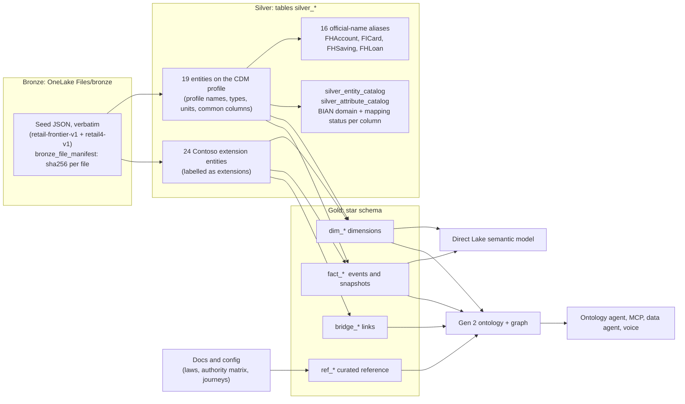
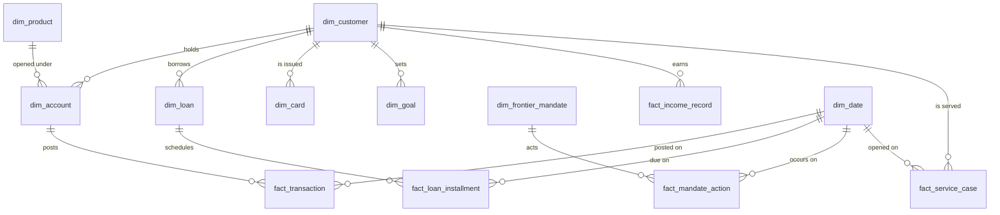

# Medallion in one lakehouse: bronze, CDM/BIAN silver, star-schema gold, ontology

The ontology is not built straight on raw JSON. The seed data passes through three layers, all in the lakehouse `ContosoBankLH`, and the
ontology and the semantic model sit on the last one only.



## What each layer holds

| Layer | Objects | Rule |
|---|---|---|
| Bronze | `Files/bronze/<release>/<file>.json`, table `bronze_file_manifest` | Raw seed, never changed. The manifest proves which bytes were used (sha256). |
| Silver | 43 tables `silver_<entity>`, plus `silver_entity_catalog` and `silver_attribute_catalog` | One table per entity, source-faithful per release, no cross-release merging. 19 tables follow the repo's CDM application profile exactly (attribute names, types, units, the seven common columns). 24 are Contoso extension entities and say so. |
| Gold | `dim_*`, `fact_*`, `bridge_*`, `ref_*` (51 tables) | Built from silver. Business keys join everything. Money is exact int64 paise plus a rupee double; rates are doubles; legacy ids are namespaced (`rhea~legacy`). |
| Semantic model | `ContosoBankModel`, Direct Lake over gold | 39 measures on core, DAX over entity names. |
| Ontology | `ContosoBankOntology`, 31 core entities | Bound to gold only. Entity names are the CDM profile's names. Entity descriptions carry the standards sentence, then the star role, grain and lineage. |

## How silver respects the BIAN-based Microsoft CDM

1. **Profile as the base.** Silver tables for Customer, Product, Account, Card, Deposit, Loan, ProtectionPolicy, Transaction, Goal, Preference, Document,
   Consent, FrontierConsent, ServiceCase, HouseholdAccessGrant, RegisteredAgent, FrontierMandate, MandateAction and ProactiveCandidate carry every attribute
   of the profile entity under its exact name, type and unit. Money stays INR paise as int64. Rates stay exact decimal text. Missing stays null.
2. **Common columns** (`id`, `label`, `state`, `sourceKind`, `historical`, `sourceRecordId`, `sourceVersion`) are filled with the app's own rules
   and vocabulary, so a record reads the same in silver as in the superapp's Banking Data X-Ray.
3. **Official-name aliases.** Where an attribute genuinely matches an official Microsoft CDM attribute, silver also carries it under the official name
   (Account 4, Card 3, Deposit 3, Loan 6). Each alias has a written rationale, the official description quoted, a unit and a null rule, and a test
   recomputes every alias value from its base column. Customer and Document have none: the official files vendored in the source repo define no matching
   attribute.
4. **BIAN lineage as data.** `silver_attribute_catalog` has one row per silver column with `bian_domain`, `bian_control_record`, `bian_mapping_status`
   (custom, provisional or unmapped, never upgraded), `official_entity`, `official_attribute`, `match_type`, the source pointer and the transform.

What this is not: Microsoft endorsement, BIAN certification, regulatory compliance, or a full CDM SDK implementation. Say "official-name alias" and
"semantic reference".

## One vocabulary: names

The full rule is [NAMING_STANDARD.md](NAMING_STANDARD.md); the short version is below.

- **Ontology entities carry the profile's names.** The 18 profile-aligned entities are `Customer`, `Product`, `Account`, `Card`, `Deposit`, `Loan`,
  `ProtectionPolicy`, `Transaction`, `Goal`, `Preference`, `Document`, `Consent`, `ServiceCase`, `HouseholdAccessGrant`, `RegisteredAgent`,
  `FrontierMandate`, `MandateAction` and `ProactiveCandidate`: the names the superapp's Banking Data X-Ray shows. The one merge is `Consent`: the
  profile's `Consent` (legacy) and `FrontierConsent` rows are one entity, fed by `silver_consent` and `silver_frontier_consent`.
- **The other 33 are Contoso extension entities.** They have no profile entity and say so in their description ("Contoso extension entity: no CDM
  profile entity, BIAN status unmapped."). `ScheduledObligation` is one of them: the profile's `Commitment` is a mandate or repayment-schedule row,
  not the seed's scheduled obligation. The nine curated reference tables (laws, authority matrix, requirements, bank agents, service request types,
  journeys, journey links, calendar) are extension entities too.
- **The lakehouse name is role plus entity**: `silver_<entity>`, `dim_<entity>`, `fact_<entity>`, `bridge_<entity>`, `ref_<entity>`, so `HouseholdAccessGrant` is
  `silver_household_access_grant` and `dim_household_access_grant`. The one exception is `dim_date`.
- **Official CDM names and BIAN names are never table or entity names.** `FHAccount` is a semantic reference and a silver alias column; `Savings Account` is
  a BIAN service domain in the catalogs and in the description sentence.
- **Seven names changed in this phase**: entities `InsurancePolicy` to `ProtectionPolicy`, `ServiceRecord` to `ServiceCase`, `AccessGrant` to
  `HouseholdAccessGrant`, `Mandate` to `FrontierMandate`, `MandateEvent` to `MandateAction` and `ProactiveEvent` to `ProactiveCandidate`, and the lakehouse table
  `fact_income` to `fact_income_record`. Properties, relationships, measures and golden questions kept their names; the old business words ("mandate",
  "access grant", "insurance policy", "service record") stay findable as synonyms and in the descriptions.

## Entity descriptions: full and compact

An entity description is the business meaning, then the standards sentence, then (in the default `full` mode) one clause built from the registry: star role, grain,
lakehouse lineage and the official-name aliases. The longest `full` line on core is 736 characters (the ontology writes the `[Domain] ` tag in front); Fabric
documents no limit and the longest entity line ever accepted live is 509. `compact` is what v1 carried, the business meaning and the standards sentence with every
line within 500 characters, and it is the safe fallback.

- Choose with `--descriptions full|compact` (`build`, `plan`, `deploy`, `agents`, `verify`, `preflight`, `up`, and `build.sh --descriptions ...`), else
  `CONTOSO_DESCRIPTIONS`, else the mode the build state remembers (`descriptionsMode` in `<state>/out/.state.json`), else `full`. An explicit choice beats the remembered one.
- A live build whose ontology or semantic-model definition Fabric refuses with HTTP 400 while the mode is `full` builds every definition again in `compact`, retries
  once, remembers the mode and says so (`DESCRIPTION FALLBACK` lines, `NEXT_STEPS.md`). A second refusal raises the original error with the retry's attached. The 403 gate
  (`FeatureNotAvailable`), throttling (429) and server errors (5xx) are not part of this.
- The data dictionary lists the star role, grain, lineage and standards facts as data in both modes: only the description text changes.

## The star

Facts carry measures and keys to dimensions; dimensions carry the descriptive attributes; bridges hold many-to-many links; `dim_date` is the shared
calendar. The same relationships drive the semantic model and the ontology graph.



Seven facts carry a date column, and each has one date-role relationship to `dim_date` in the semantic model (transaction, loan instalment, CRM case, mandate
action, incident, service case, proactive candidate). These relationships are semantic-model only: the ontology does not use them. Facts without a date column
get none. With them the semantic model has 36 relationships on core and 56 on full (v1: 35 and 54); the ontology still has 53 and 78.

## See it in Fabric

1. Lakehouse `ContosoBankLH`: `Files/bronze` for the raw seed, then the `silver_*` tables, then `dim_*`, `fact_*`, `bridge_*`, `ref_*`.
2. SQL analytics endpoint, standards as data:
   ```sql
   SELECT silver_table, profile_entity, cdm_reference_entity, bian_domains, row_count
   FROM silver_entity_catalog ORDER BY extension, silver_table;

   SELECT column_name, origin, bian_domain, bian_mapping_status, official_entity, official_attribute
   FROM silver_attribute_catalog WHERE silver_table = 'silver_account';
   ```
3. Ontology: open an entity (for example Account). The description ends with the standards sentence (the BIAN domains with their status and the official CDM entity
   as a semantic reference, or "Contoso extension entity" when there is no profile entity) and then the star role, the grain, the lakehouse lineage
   (`dim_account <- silver_account <- accounts.json`) and the official-name aliases.

## Verify without Azure

All of this is checked offline: silver conformance against the profile, the alias recomputation, gold against the frozen pre-medallion output (51 tables,
2,501 rows, 29 golden answers), star grain and key checks, a lineage test, the naming standard (every lakehouse and entity name against its rule, the official-name
and BIAN deny-lists) and the standards checks (profile relationships, keys, BIAN status words). Nothing here needs a Fabric capacity; the F4 is only for the live demo.
