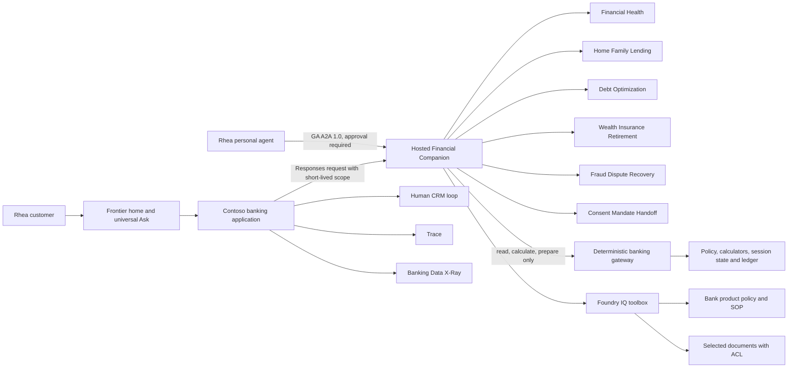
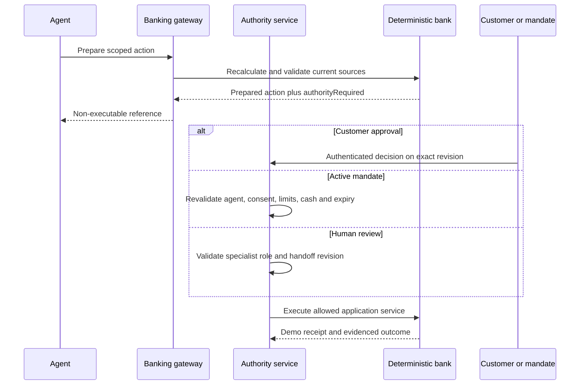
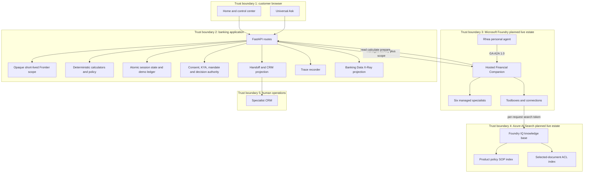
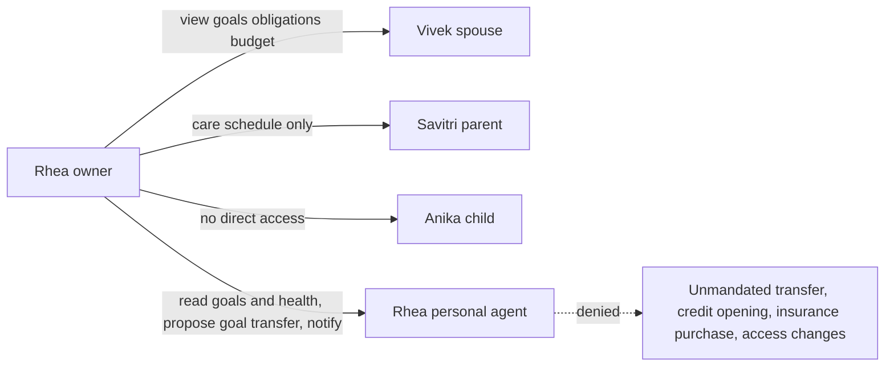

# Frontier Retail Bank: strategy, PRD, architecture and handover

**Repository:** `hrshl-demo/contoso-retail-superapp4`
**Continuation baseline:** `hrshl-demo-potential-adventure` at
`2c9e8c79ae6e983d2d3f286b9fe15012cdec4928` or later
**Document scope:** strategy, product requirements, architecture and handover;
no application, release, Foundry, infrastructure or deployment changes
**Evidence posture:** repository implementation and offline validation only;
no Azure write, live Foundry validation, live model invocation or deployment is
claimed by this document

Frontier is a customer-visible continuation of the existing conversational
banking spine, Trace and Banking Data X-Ray. It narrows the demo to one
synthetic household, six composite outcomes and a governed agent architecture.
It does not replace the deterministic bank, invent a second source of truth or
turn an AI recommendation into banking authority.

## 1. Definition

Frontier Retail Bank is an **AI-native household financial companion** for one
synthetic customer, Rhea Bansal. It combines:

- a home experience that explains household position, upcoming pressure,
  goals, attention items, active journeys and authority;
- a universal **Ask** entry point that returns to the same persistent
  conversation from every Frontier surface;
- six composite journeys, F01-F06, that cover fourteen retail requirements;
- one Python hosted Microsoft Foundry **Financial Companion** orchestrator;
- six managed prompt specialists, one separate Rhea personal agent and one
  shared `gpt-5.4-mini` deployment;
- Foundry IQ retrieval over bank product, policy and SOP material plus
  permission-filtered selected customer documents;
- deterministic banking gateway, calculators, policy, exact-money, state,
  consent, mandate, decision, ledger, CRM and observability services;
- one narrowly bounded surplus-to-goal mandate, not general account autonomy;
- an actionable human specialist loop with durable CRM continuity; and
- Trace for software execution plus Banking Data X-Ray for customer-data
  meaning and lineage.

**Not in the definition:** a real core-banking integration, a market-data feed,
an insurer connection, production advice, real payments, real underwriting,
production fraud operations or a deployed Foundry estate. All committed
customers, institutions, balances, products, policies, documents and effects
are synthetic demo records.

### Delivery status legend

| Status | Meaning in this repository |
|---|---|
| **Implemented/offline** | Code or assets exist and can be exercised with deterministic local data or explicit doubles. |
| **Planned/live-gated** | Contract and integration path exist, but activation needs human approval, configuration, provisioning and live validation. |
| **Synthetic demo effect** | A deterministic record demonstrates lifecycle behavior; it is not a production transaction or external-system result. |
| **Preview/no SLA** | The design depends on a Microsoft preview surface that must be revalidated before production use. |

## 2. Vision

Frontier should make the bank feel like one continuous relationship rather than
a catalogue of products and disconnected service journeys. Rhea should be able
to ask, “Can we afford the home without weakening school fees, emergency cash
or retirement?” and receive a source-backed answer that:

1. uses current household records and selected evidence;
2. exposes assumptions, trade-offs and uncertainty;
3. delegates analysis without delegating authority;
4. prepares exact next steps without claiming execution;
5. involves a human when risk, vulnerability, regulation or evidence requires
   judgment; and
6. leaves a durable, inspectable trail in the customer record, Trace and
   Banking Data X-Ray.

The target experience is proactive but calm: surface only server-proven
attention items, explain why they matter and allow the customer to defer,
change assumptions, revoke access or ask a different question.

## 3. Maturity comparison

| Capability | Legacy Jxx demo | Conversational banking spine | Frontier implemented/offline | Production target |
|---|---|---|---|---|
| Customer model | Three visible personas | Shared goal-led relationship memory | One visible Rhea household; legacy personas test-only | Authenticated multi-customer tenancy |
| Entry model | J01-J12 openers and compatibility playbooks | Free-text planning across a reviewed catalogue | Universal Ask plus F01-F06 catalogue | Omnichannel continuity with production identity |
| Outcome model | Journey-specific stages | Multi-product plans and forms | Six household outcomes covering fourteen requirements | Measured financial and service outcomes |
| AI topology | Single conversational model path | Shared relationship planner | Hosted orchestrator plus six specialists and separate personal agent scaffold | Deployed, evaluated and operationally supported agents |
| Knowledge | Seed catalogue, SOPs and selected evidence | Source-visible reads and corrections | Foundry IQ contracts for policy/SOP and selected-document ACL | Live governed ingestion, freshness and retrieval evaluation |
| Financial logic | Typed chapters and exact-money helpers | Deterministic presentations, decisions and effects | Registered calculators, policy and gateway; AI cannot author figures | Production systems of record and reconciled adapters |
| Authority | Explicit review/apply/execute boundaries | Durable consent and effect receipts | Customer approval, active mandate and human-review paths separated | Strong customer authentication and production entitlements |
| Human collaboration | Existing CRM cases | Cross-channel continuity | Consent-bound handoff, specialist action matrix and return loop | Staff identity, queues, SLA, audit and operating model |
| Observability | Trace | Trace plus durable records | Trace plus Banking Data X-Ray retained | Security monitoring, model evaluation and regulated audit |
| Deployment evidence | Existing app deployment history | Local and prior branch evidence | No Frontier live deployment or Foundry validation claimed | Approved release, resilience, rollback and live evidence |

Frontier is therefore an **engineering-complete offline demonstration
architecture**, not a production-qualified bank.

## 4. Principles

1. **Household goals before product sales.** Start from the outcome and shared
   resource envelope, not a preselected product.
2. **AI proposes; deterministic services prove.** The model may frame,
   delegate and explain. Exact money, eligibility, policy and state changes
   come from registered services.
3. **One source of banking truth.** The atomic customer session snapshot and
   approved release data remain authoritative; Foundry does not become a
   shadow ledger.
4. **Minimum necessary context.** Every agent, specialist, human and retrieval
   request receives only purpose-scoped data.
5. **Authority is explicit and revocable.** Reading, proposing, approving,
   mandating, executing and reviewing are different grants.
6. **Service before selling.** Fraud, disputes, coercion, vulnerability and
   unresolved harm block product selling.
7. **Evidence before confidence.** Missing policy, source or customer
   confirmation remains missing; the system does not improvise a success.
8. **Continuity without lock-in.** Rhea can change assumptions, pause,
   revoke, decline, return from a human handoff or ask an unrelated question.
9. **Observable, not theatrical.** Trace reports executed software work;
   Banking Data X-Ray reports authorized data and lineage. Neither invents
   activity.
10. **Progressive autonomy.** Expand delegated action only after observed
    reliability, bounded loss, revocation and recovery are proven.

## 5. Laws

These laws are non-negotiable design and acceptance constraints.

| Law | Required behavior |
|---|---|
| **L1: No figure without authority** | A model-authored balance, rate, forecast, affordability result or executable amount is rejected as banking truth. |
| **L2: No invisible source use** | Customer documents must be selected and authorized; selected-document retrieval must apply per-request ACL context. |
| **L3: No consent by implication** | A conversation, upload, recommendation, prior consent or personal-agent request cannot create a new permission. |
| **L4: No execution by language** | “Do it,” an agent tool call or a specialist recommendation is not sufficient unless the correct authority endpoint and current revision accept it. |
| **L5: No double allocation** | Cash, collateral, commitments and goal balances cannot be counted twice across simultaneous plans. |
| **L6: No future money as cash** | Forecast income, refunds, offers, claims and unposted proceeds are not spendable balances. |
| **L7: No stale authority** | Changed sources, assumptions, balances, policy, journey revision, consent or mandate require revalidation. |
| **L8: No self-expanding agent** | An agent cannot register itself, broaden scopes, grant consent, create a mandate or approve its own prepared action. |
| **L9: No sales during harm** | F05 remains service-first and selling-blocked until the risk or dispute state permits otherwise. |
| **L10: No synthetic-to-live confusion** | Fixtures, offline doubles, seeded histories and demo effects must remain labelled and cannot be cited as live provider or production evidence. |
| **L11: No cross-household leakage** | Owner, household, scenario generation, scope token, document ACL and CRM context stay aligned. |
| **L12: No deployment without gates** | `retail-frontier-v1` remains inactive until human approval, descriptor pinning, runtime configuration, Foundry provisioning and live validation are separately authorized. |

## 6. Persona and household

Rhea Bansal is the only customer-visible primary owner in Frontier. The
synthetic household is deliberately small enough to understand and rich enough
to expose consent and competing-goal problems.

| Person | Relationship | Demo role | Default access |
|---|---|---|---|
| **Rhea Bansal** | Primary customer, age 41, Pune, salaried | Owns accounts, goals, consents, agent registration and mandates | Full owner authority through authenticated bank surfaces |
| **Vivek Bansal** | Spouse | Shared goals, scheduled obligations and household budget | View-only grant; no private messages, transactions or access changes |
| **Anika Bansal** | School-age dependent child | Education goal and household planning context | No direct access; inactive minor grant |
| **Savitri Bansal** | Elderly dependent parent | Care schedule and household protection context | Care-schedule view only; no account or transaction access |

Rhea’s data release contains two accounts, one card, two loans, one deposit,
four investments, three insurance records, six goals, eight scheduled
obligations, twelve customer documents, two incidents and six posted months
from April through September 2026. Those counts describe synthetic committed
data, not a production customer profile.

Legacy `nivedita`, `ravi` and J01-J12 assets remain compatibility and regression
material. In Frontier mode they are not customer-visible or customer-routable.

## 7. AI-native home and universal Ask

The Frontier home is a household briefing, not a product dashboard. Its
server-owned projection includes:

- available cash, assets, liabilities and net position;
- six-month flow, upcoming obligations and emergency-fund progress;
- goals, loans, investments, insurance and household members;
- ranked attention items derived from current records only;
- active journeys and next steps;
- recent agent, mandate and human actions;
- authority summary, pending approvals and current mandate/agent state; and
- fraud controls and a direct human-assistance path.

Every Ask bar routes to `/website/chat` and the existing persistent chat
transport. The customer can begin from an attention item or type an unrelated
request. A `404` from `GET /api/frontier/home` leaves the existing net-banking
experience intact.

**Home requirements**

- Exact numbers, dates, counts and status are API-owned.
- Attention items expose evidence, calculation and policy references on
  demand.
- No attention item may be created solely from a proactive scenario fixture.
- Empty attention is a valid calm state, not a failure.
- Fixture mode is explicit through `?frontier-fixtures=1` or
  `window.__FRONTIER_FIXTURES__ = true`, carries a persistent test-data banner
  and labels mandate controls as simulations.
- Home, portfolio, journey and control-center views must agree on owner,
  portfolio fingerprint and current revisions.

## 8. Six journeys and exact fourteen-requirement crosswalk

The fourteen requirements are the exact `mandatoryOutcomes` registered under
F01-F06. This is the authoritative six-to-fourteen crosswalk.

| Requirement | Retail requirement | Journey | Implemented deterministic outcome |
|---|---|---|---|
| **R01** | Monthly financial health | **F01 Financial Health & Emergency Fund** | Cash-flow forecast and ranked current-record triggers |
| **R02** | Emergency fund | **F01** | Essential/commitment basis, target months, available reserve and gap |
| **R03** | Home-buying affordability | **F02 Home, Education & Major Purchase** | Loan affordability under income, commitments, down payment, rate and term |
| **R04** | Education planning | **F02** | Goal gap, target date, required monthly allocation and conflict |
| **R05** | Major-purchase affordability | **F02** | Shared-surplus consequence alongside home and education |
| **R06** | Life event | **F02** | Revised assumptions and recalculation with reversible journey history |
| **R07** | Debt optimization | **F03 Debt Optimizer** | Exact debt cost, burden and protected-cash prepayment scenarios |
| **R08** | Idle-cash investment | **F04 Wealth, Insurance & Retirement** | Liquidity floor plus non-like-for-like deposit/SIP projections |
| **R09** | Retirement readiness | **F04** | Corpus, contribution, horizon and assumed-return projection |
| **R10** | Insurance gap | **F04** | Existing protection, target protection, gap and disclosure |
| **R11** | Scam intervention | **F05 Scam Shield, Dispute & Recovery** | Risk signals, temporary protection operations and service-first path |
| **R12** | Card dispute and replacement | **F05** | Dispute state, card state, replacement preparation and evidence references |
| **R13** | Human escalation | **F05** | Consent-bound specialist handoff and durable CRM case |
| **R14** | Customer agent | **F06 Delegated Household Agent** | KYA, scopes, denied actions, consent, grants, prepare-only default and mandate status |

### Journey behavior

| Journey | Primary specialists | Autonomy ceiling | Allowed prepared operations |
|---|---|---:|---|
| F01 | Financial Health; Consent/Mandate/Handoff | 5 | `surplus_to_goal` |
| F02 | Home/Family/Lending; Financial Health | 4 | `goal_allocation`, `home_deposit_reservation` |
| F03 | Debt Optimization; Financial Health | 4 | `debt_prepayment` |
| F04 | Wealth/Insurance/Retirement; Financial Health | 4 | `deposit_open`, `sip_start`, `insurance_review` |
| F05 | Fraud/Dispute/Recovery; Consent/Mandate/Handoff | 6 | `temporary_payment_hold`, `card_lock`, `dispute_open`, `card_replacement`, `service_escalation` |
| F06 | Consent/Mandate/Handoff; Financial Health | 5 | `goal_transfer`, `surplus_to_goal` |

An autonomy ceiling describes the maximum type of workflow the journey may
request. It does not grant customer, mandate or human authority.

## 9. Multi-agent model

Frontier uses one bank orchestrator, six bank specialists and one customer-side
agent.

| Agent | Form | Responsibility | Direct ledger authority |
|---|---|---|---|
| **Financial Companion** | Python hosted Foundry agent using Microsoft Agent Framework and Responses protocol | Understand goal, request minimum context, retrieve evidence, call deterministic tools, delegate and consolidate | None |
| Financial Health | Managed prompt specialist | Cash flow, emergency reserve and household health | None |
| Home/Family/Lending | Managed prompt specialist | Home, education, major purchase and lending trade-offs | None |
| Debt Optimization | Managed prompt specialist | Debt cost and repayment options | None |
| Wealth/Insurance/Retirement | Managed prompt specialist | Liquidity, investing, protection and retirement | None |
| Fraud/Dispute/Recovery | Managed prompt specialist | Scam, card, dispute and recovery analysis | None |
| Consent/Mandate/Handoff | Managed prompt specialist | Authority explanation, mandate boundaries and human routing | None |
| **Rhea personal agent** | Separate managed prompt agent | Represents Rhea within supplied permissions and communicates with the bank | None |

All eight agents reference the same `gpt-5.4-mini` deployment. The specialists
are reachable from the orchestrator through GA A2A 1.0 tools. Rhea reaches the
bank only through a separate A2A 1.0 connection to the Financial Companion;
the Rhea toolbox requires approval. Rhea is not a seventh bank specialist and
cannot impersonate the bank.

The committed Foundry assets are an offline-first scaffold. They do not prove
that any agent, toolbox, connection, Search object or hosted endpoint exists.

## 10. Autonomy and authority matrix

Frontier separates analysis, preparation and effect. The default agent action
mode is prepare-only.

| Capability | Customer | Financial Companion | Specialist | Rhea agent | Active mandate | Human specialist | Deterministic bank |
|---|---:|---:|---:|---:|---:|---:|---:|
| Ask or change goal | Yes | Interpret | Advise | Relay within scope | No | Clarify | Persist conversation |
| Read scoped banking context | Authorize/use | Request | Receives minimum subset | Only granted subset | Referenced records only | Consented package only | Enforce scope |
| Run financial calculation | Request | Invoke | Recommend inputs | Request through bank | No | Review result | Compute exact result |
| Retrieve policy/SOP | View citation | Invoke | Use retrieved evidence | Through bank only | No | View if authorized | Enforce retrieval contract |
| Prepare action | Initiate | May request | Recommend only | Only permitted proposal scope | May support one matching operation | May modify where role permits | Validate and record |
| Approve customer action | Yes, separate authenticated decision | No | No | No | No | No | Record current decision |
| Execute bounded surplus action | Revoke/pause/resume | No | No | No direct ledger call | Yes, only after revalidation | No | Execute and record demo effect |
| Accept/modify/reject referred case | No | No | No | No | No | Yes, role-specific | Enforce actor, revision and action matrix |
| Expand consent or mandate | Yes, through authority surface | No | No | No | No | No | Enforce |
| Write arbitrary ledger mutation | No | No | No | No | No | No | Not exposed |

The banking gateway OpenAPI contract exposes context read, registered
calculations and non-executable action preparation. It intentionally has no
general execute endpoint. Application services contain separate execution
paths for authenticated customer decisions and an active mandate.

### Bounded surplus-to-goal mandate

The only delegated money pattern is `surplus_to_goal`. The synthetic release
contains one Rhea mandate with:

- one source account and one target goal;
- INR 20,000 per-action cap;
- INR 40,000 monthly aggregate cap;
- INR 750,000 minimum source balance after action;
- validity dates, revision, consent and registered-agent binding;
- current-balance, protected-cash, prior-allocation and monthly-use
  revalidation; and
- pause, resume and revoke controls with optimistic concurrency.

Its seeded history includes an INR 15,000 synthetic action, a later skipped
action because school/card obligations were protected and a customer
revocation. Those are demo records, not a live transfer history.

## 11. Human collaboration

Human escalation is a first-class journey state, not a transcript export or a
generic “contact us” fallback.

1. The Financial Companion identifies a handoff condition.
2. The bank validates a current journey revision and a context package.
3. Every shared context reference must be covered by active consent for the
   assigned specialist role.
4. The journey pauses as `waiting_human`; a durable handoff and CRM case are
   created.
5. A server-authenticated specialist sees the package, model references, bank
   decision references and allowed actions.
6. The specialist may accept, reject, request information, return to customer
   or, for mortgage/financial-adviser roles, modify an allowlisted set of
   fields.
7. Requested information pauses the journey as `waiting_customer`; evidence
   can be returned without losing context.
8. Return to customer resumes the journey against the recorded human decision.

| Specialist role | Allowed decisions | Allowlisted modification |
|---|---|---|
| Fraud specialist | Accept, reject, request information, return | None |
| Mortgage specialist | Accept, modify, reject, request information, return | Amount, conditions, term, next steps |
| Financial adviser | Accept, modify, reject, request information, return | Recommendation, assumptions, conditions, next steps |
| Service specialist | Accept, reject, request information, return | None |

CRM projection preserves model recommendation, bank decision, human decision,
context versions and lifecycle status without conflating their authors.
Reused changed command IDs, stale revisions, wrong roles and cross-owner reads
are refused.

## 12. Logical architecture and trust boundaries

### Boundary rules

- Browser data is untrusted input; exact values are returned by the server.
- The short-lived `X-Frontier-Scope` is owner, household, purpose and
  tool-bound, then revoked after the turn.
- Foundry identity authenticates the caller but does not provide banking
  authority.
- The selected-document Search token is passed per request as
  `x-ms-query-source-authorization` and must not be persisted.
- Specialists do not receive banking gateway tools directly.
- The deterministic banking application is the only component that can create
  a prepared action, accept authority or record a demo effect.
- Human CRM actions require server-authenticated role, owner scope, consent,
  command idempotency and current revisions.
- Trace and Data X-Ray are read/observe surfaces, not control planes.

## 13. Data and integration architecture

### Data planes

| Plane | Source | Authority | Current status |
|---|---|---|---|
| Synthetic banking portfolio | `data/releases/retail-frontier-v1` | Deterministic committed release; descriptor remains `in_review` | Implemented/offline |
| Existing catalogue, policies and SOPs | `data/releases/retail4-v1` | Approved demo reference material | Implemented/offline |
| Selected customer documents | Existing banking document/evidence path | Customer selection, read consent, revision and provenance | Implemented/offline; planned Search ingestion |
| Session and journey state | Atomic owner snapshot | Current runtime source of truth | Implemented/offline |
| Foundry conversation state | Responses `previous_response_id` reference | Conversation continuity only; no banking authority | Planned/live-gated |
| CRM handoff | Frontier owner snapshot plus CRM projection | Durable handoff and human decision record | Implemented/offline |
| Trace | Instrumented execution events | What software/provider work actually ran | Implemented |
| Banking Data X-Ray | Authorized projection of current records and lineage | Meaning and relationships of banking data | Implemented |

### Foundry IQ and toolbox

The planned knowledge base is extractive and combines:

1. bank product terms;
2. bank policy and SOP content; and
3. selected customer documents carrying Entra user/group and optional RBAC
   scope metadata.

The orchestration toolbox combines Foundry IQ MCP retrieval, the least-
privilege OpenAPI banking gateway and six A2A specialist tools. The Rhea
toolbox contains only the A2A connection to the bank Financial Companion.

### Integration non-claims

- No real core-banking host or payment rail is connected.
- No bureau, market-price, fund, insurer, claims, merchant, card-network,
  identity registry or government source is connected.
- Product rates and policy are synthetic approved demo content.
- KYA is a synthetic registry fixture, not an external certification.
- Search indexes, knowledge sources and knowledge base are specifications, not
  evidence of provisioned Azure resources.
- The Financial Companion client and runtime wiring are implemented contracts,
  not proof of a reachable hosted agent.

## 14. Security, governance and responsible AI

| Control area | Frontier requirement |
|---|---|
| Identity | Managed identity for Foundry and Search; authenticated bank/browser and specialist actors; no credentials in prompts or URLs |
| Least privilege | Purpose-bound scope tokens, scoped data refs, allowlisted tools and role-specific actions |
| Data minimization | Minimum context to orchestrator/specialist/human; selected-document ACL and metadata-only states before read |
| Prompt/data separation | Trusted instructions remain separate from customer, source and tool data |
| Exact money | Integer paise plus currency; deterministic calculators; no model-authored financial truth |
| Consent | Specific subject, purpose, resource, permission, expiry and revocation |
| Integrity | Expected revisions, idempotency keys, source refs, fingerprints and stale-state conflicts |
| Fraud/vulnerability | Service-first, selling-blocked path; human handoff for coercion, vulnerability and ambiguity |
| Transparency | Citations, calculation/evidence/prepared-action refs, specialist list, consent state and next steps |
| Observability | Trace for execution and Data X-Ray for data lineage; sanitized events and owner/session isolation |
| Human accountability | Model recommendation, bank decision and human decision remain distinct records |
| Release governance | Human approval and immutable descriptor pin required before runtime activation |

### Responsible-AI evaluation requirements

Before live qualification, evaluate at minimum:

- grounding and citation correctness across all fourteen requirements;
- refusal to invent figures, policy, approvals, actions or source content;
- specialist routing and disagreement preservation;
- prompt-injection resistance from user and selected documents;
- permission and ACL isolation;
- stale-revision, replay and cross-household attacks;
- service-first behavior under fraud, coercion and vulnerability;
- harmful or unsuitable recommendation rates;
- demographic and household-role fairness;
- clear disclosure of assumptions, uncertainty, demo data and human options; and
- recovery from Foundry, Search, gateway and CRM failures without
  success-shaped fallback.

No such live-model evaluation is claimed here.

## 15. Household consent model

Household authority is resource-specific and asymmetric. Relationship does not
imply permission.

The runtime checks active household grants and consents by owner, subject,
resource, permission, validity and revocation. Human handoff consent is
separate from household sharing. Agent read consent is separate from mandate
consent. A customer action decision cannot create or expand any of them.

**Required controls**

- One customer control center lists access, consents, registered agent,
  mandates, pending approvals, handoffs and recent actions.
- Pause/resume/revoke commands are revision-bound and idempotent.
- A revoked mandate cannot execute; an expired mandate cannot resume.
- A minor has no inferred household data access.
- Private messages, accounts and transactions remain outside spouse/dependent
  grants unless explicitly added through a future reviewed flow.

## 16. Know Your Agent (KYA)

KYA is the registration and verification boundary for a non-bank agent. It is
not customer authentication, consent, a mandate or proof of good advice.

The committed Rhea fixture includes:

- provider name `Frontier Personal Agent Demo`;
- synthetic provider registration `SYN-KYA-FPA-0001`;
- signing-key fingerprint;
- synthetic registry verification method and timestamp;
- read and proposal scopes;
- explicitly denied scopes; and
- separate consent and household grant references.

Before any delegated action, the bank must verify:

1. registered agent identity and status;
2. current signing identity/fingerprint;
3. validity period;
4. requested data and action scopes;
5. owner and household alignment;
6. matching active consent;
7. matching active mandate when money movement is requested;
8. current balance, protected cash, per-action/monthly limits and expiry; and
9. immutable audit identifiers for request, decision and effect.

Production KYA additionally needs a real trust registry, key rotation and
revocation, provider accountability, incident response, certification policy
and customer-readable provenance. None is implemented by the synthetic fixture.

## 17. KPIs and success metrics

Metrics must distinguish demo plumbing, model quality, banking control quality,
customer outcome and human operations.

| Dimension | Metric | Target for live pilot qualification |
|---|---|---:|
| Coverage | F01-F06 and R01-R14 accepted against defined cases | 100% |
| Grounding | Bank-specific claims with valid evidence/policy refs | >= 98% |
| Financial correctness | Deterministic calculation reconciliation | 100% |
| Fabrication | Unsupported balances, rates, policy, approval or execution claims | 0 |
| Authority | Unauthorized execution or scope expansion | 0 |
| Isolation | Cross-owner/household/document leakage | 0 |
| Journey quality | Customer reaches correct next state without forced product outcome | >= 90% |
| Service-first safety | Fraud/vulnerability cases with selling blocked and correct escalation | 100% |
| Human loop | Handoffs with complete consented context and durable return | >= 99% |
| Customer control | Pause/revoke reflected before another delegated effect | 100% |
| Explainability | Recommendations exposing assumptions and requested references | >= 95% |
| Retrieval | Relevant policy/SOP/selected-document evidence in evaluated set | >= 95% |
| Reliability | Successful turn or explicit recoverable failure, no false success | >= 99.5% |
| Latency | P95 simple Ask / multi-specialist Ask | <= 8s / <= 20s pilot targets |
| Operations | P95 high-risk human acknowledgement | <= 5 minutes during staffed demo/pilot |
| Observability | Executed turns with trace identity and auditable state change | 100% |
| Customer outcome | Emergency gap, debt cost, protection gap or case state measurably improved | Report separately; never infer from engagement |

Offline fixture/test counts are engineering evidence and must not be reported as
these live KPIs.

## 18. Qualification scorecard

This scorecard is a handover decision aid, not an external certification. The
current score reflects repository evidence only.

| Area | Weight | Current | Evidence and gap |
|---|---:|---:|---|
| Strategy, scope and customer proposition | 8 | 8 | One household, six outcomes and explicit non-claims |
| Journey coverage and deterministic calculations | 12 | 12 | F01-F06 and fourteen outcomes implemented with exact-money tests |
| Authority, consent, mandate and stale-state safety | 15 | 15 | Separate customer/mandate/human paths and revisions |
| Human collaboration and CRM continuity | 8 | 8 | Actionable consent-bound handoff lifecycle |
| Data model, lineage and observability | 10 | 10 | Trace and Banking Data X-Ray retained |
| Customer experience and control center | 10 | 10 | Home, portfolio, journeys, action history and mandate controls |
| Foundry asset completeness and offline validation | 10 | 7 | Hosted code, schemas, cards, toolboxes and knowledge contracts exist; no live resources |
| Live model/retrieval quality and RAI evaluation | 12 | 0 | Not authorized or performed |
| Deployment, reliability, rollback and support | 8 | 0 | No Frontier deployment or operational evidence |
| Production integrations, legal and operating readiness | 7 | 0 | Synthetic adapters only; no real bank/market/insurer/KYA registry |
| **Total** | **100** | **70** | **Engineering demo qualified; deployment and production gates fail** |

**Qualification rule:** production or external pilot requires at least 85/100
and cannot compensate for a zero in live model/RAI, deployment/reliability or
production authority/security gates. The current implementation may be
demonstrated locally with synthetic data, but it is not qualified for live
customer use.

## 19. Four-stage roadmap

### Stage 1: Baseline and offline acceptance - implemented

- Preserve the conversational spine, Trace and Banking Data X-Ray.
- Keep one Rhea household and hide legacy personas/Jxx from Frontier customers.
- Validate deterministic release, exact money, journeys, authority, handoff,
  UI contracts and Foundry assets offline.
- Keep `retail-frontier-v1` as `in_review`; do not activate it.

**Exit:** focused tests and documentation agree; no live claim.

### Stage 2: Controlled Foundry integration - planned/live-gated

- Obtain explicit Azure-write approval.
- Provision/select Foundry project and shared `gpt-5.4-mini`.
- Provision Search indexes, knowledge sources, extractive knowledge base and
  per-request ACL path.
- Create six prompt specialists, Rhea, A2A connections and toolboxes.
- Publish toolbox versions, then deploy the hosted Financial Companion.
- Run connectivity and structured-contract smoke tests without financial
  effects.

**Exit:** exact resource identities, API versions, permissions, costs and
provider provenance recorded; no production customer traffic.

### Stage 3: Live evaluation and internal pilot - planned

- Activate only an approved, hash-pinned synthetic release.
- Run all fourteen requirements, adverse cases, ACL tests, prompt-injection
  tests, failure recovery, Trace and Data X-Ray evidence.
- Measure the Section 17 KPIs and complete security, privacy, RAI, legal and
  operations reviews.
- Exercise human queues, mandate revoke races, model/Search outages and
  rollback.

**Exit:** scorecard threshold met with all noncompensable gates passing.

### Stage 4: Production integration and bounded rollout - future

- Replace synthetic adapters with reconciled core-banking, identity, payment,
  market/insurer and case-management integrations as separately approved.
- Implement production KYA registry and key lifecycle.
- Define product/advice perimeter, records retention, complaints, support,
  model change governance and incident response.
- Begin read-only/co-pilot use, then preparation, then narrowly bounded
  delegated action only after outcome and loss evidence.

**Exit:** regulator, risk, security, architecture and business owners approve
the exact production scope. No general autonomous banking is implied.

## 20. Multi-day final storyboard, demo script and source limitations

### Four-day final storyboard

| Day | Customer story | Surfaces and evidence | Required ending |
|---|---|---|---|
| **Day 1: Understand** | Rhea opens Home, sees emergency-fund and debt attention, then asks whether the household can afford a home without harming school fees. | Home, universal Ask, F01/F02, exact calculations, assumptions, citations, Trace | A reversible household plan; no application or money movement |
| **Day 2: Optimize** | Rhea changes the home date, compares debt prepayment, idle cash, retirement and insurance gaps. | F02-F04, calculation refs, journey revisions, Data X-Ray relationships | Prioritized options with protected cash and no double allocation |
| **Day 3: Protect and collaborate** | A scam concern and duplicate charge trigger service-first handling and a fraud-specialist handoff. | F05, card controls as prepared actions, consented context, CRM, Trace, Data X-Ray | Open/reviewed case with explicit human decision; no selling |
| **Day 4: Delegate and govern** | Rhea reviews her personal agent, KYA, scopes and mandate history; demonstrates prepare-only behavior and revocation. | F06, control center, A2A architecture explanation, mandate pause/revoke, action history | Customer remains in control; no unmandated action |

### Concise 12-minute demo script

1. **Home - 90 seconds:** identify Rhea and the Bansal household, synthetic
   disclosure, current position, emergency progress and ranked attention.
2. **Ask - 2 minutes:** ask, “Can we afford the home without putting school
   fees or emergencies at risk?” Show F02 assumptions, deterministic
   affordability and goal conflict.
3. **Revise - 90 seconds:** move the target date and show a new revision rather
   than an overwritten answer.
4. **Optimize - 2 minutes:** open F03/F04 results, protected cash, debt cost,
   idle-cash comparison, retirement and protection gap. State that projections
   are not market or insurer quotes.
5. **Protect - 2 minutes:** open F05, demonstrate selling blocked, prepared
   protection actions and the human fraud handoff.
6. **Govern - 90 seconds:** open the control center; show household permissions,
   KYA, denied scopes, pending approvals and the revoked surplus mandate.
7. **Prove - 90 seconds:** use Trace to show executed software work and Banking
   Data X-Ray to show data/lineage. Explain that neither surface performs the
   action it observes.

If a live Foundry endpoint is not separately provisioned and validated, run the
demo in labelled offline/fixture mode and explicitly say so. Do not substitute
a fixture response while calling it live.

### Source and limitation matrix

| Claim | Repository source | What it proves | Limitation |
|---|---|---|---|
| One Rhea household | `data/releases/retail-frontier-v1/personas.json`, `household.json` | Synthetic primary owner, spouse, child and elderly parent | Not a real customer or identity system |
| Six journeys/fourteen outcomes | `config/frontier-retail.json` | Exact F01-F06 definitions and `mandatoryOutcomes` | Does not prove live model completion |
| Deterministic journey logic | `app/frontier/journeys.py`, `calculators.py` | Exact calculations and current-record evaluation | Synthetic inputs; no market/core-bank feed |
| Authority and mandate | `app/frontier/authority.py`, `actions.py`, `mandates.json` | Scope, cash floor, caps, expiry, revision and effect lifecycle | Seeded actions are synthetic demo history |
| Household consent and KYA | `access-grants.json`, `consents.json`, `agents.json` | Explicit permissions, denied scopes and synthetic registration | No production trust registry |
| Human CRM loop | `app/frontier/handoff.py`, `handoff_routes.py` | Consented context, role actions, revisions and return lifecycle | Demo specialist identity; no enterprise queue/SLA |
| Frontier home and controls | `app/frontier/projections.py`, `routes.py`, `web/js/frontier/*` | Rhea-scoped API projections and mandate controls | Browser fixtures are not agent evidence |
| Financial Companion | `foundry/src/financial-companion/*` | Hosted Python code and response contract | Preview hosting package; not deployed or invoked here |
| Six specialists and Rhea | `foundry/agents/*`, `provisioning/agents.yaml` | Agent definitions and shared model reference | Definitions are not live agent versions |
| GA A2A 1.0 topology | `foundry/provisioning/connections.yaml`, `toolboxes.yaml` | Protocol and least-privilege connection design | Endpoints are placeholders until provisioned |
| Foundry IQ and ACL | `foundry/provisioning/knowledge/*` | Extractive KB, policy/SOP source plan and selected-document permission fields | IQ MCP, toolbox and query-time ACL surfaces include preview/no-SLA dependencies |
| Banking gateway | `foundry/contracts/banking-gateway.openapi.yaml`, `app/frontier/gateway.py` | Read/calculate/prepare contract and server-side authority | No general execute endpoint; no real core bank |
| Trace | `app/tracing/*`, `web/js/trace/*` | Observed software/provider execution | Does not prove banking-data truth |
| Banking Data X-Ray | `docs/banking-data-xray.md`, `app/data_xray/*` | Authorized data meaning and lineage | Read-only; not an action or external certification |
| Release gate | `data/releases/retail-frontier-v1/release.json`, `docs/frontier-retail-data.md` | Deterministic descriptor is `in_review` and must be pinned | Not runtime-approved or deployed |
| Offline Foundry validation | `foundry/tests/test_assets.py`, `foundry/scripts/validate_assets.py` | Schema/configuration consistency | No live Foundry, Search, model or latency result |

### Handover deployment gate

The next implementer must not claim Frontier is live merely because the
repository contains `azure.yaml`, hosted-agent code or provisioning manifests.
Before any deployment:

1. obtain explicit authorization for Azure writes and deployment;
2. approve and hash-pin the Frontier release descriptor;
3. verify runtime configuration matches Rhea, F01-F06, portfolio version and
   maximum autonomy;
4. provision in the documented dependency order;
5. record exact agent, toolbox, connection, model and Search resource
   identities;
6. run live retrieval/model/ACL/authority/RAI tests;
7. verify Trace and Banking Data X-Ray against the deployed build; and
8. retain an honest rollback path to the existing experience.

Until those steps are complete, the correct status is: **implemented and
validated offline; live deployment and Foundry behavior not validated**.
